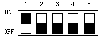

# Dial switch

Each HM series HMI has dial switch, each of which has its functions.

**Function list of dial switch**

|                   |                             |
|-------------------|-----------------------------|
| Dial switch (5-1) | Function                    |
| All off           | Normal Operation Mode       |
| On 1              | Coordinate Calibration Mode |
| On 2              | Parameter Display Mode      |
| On1 and On2       | Terminal Mode               |
| On 1 and On3      | Parameter Setting Mode      |

Note:

It needs to restart HMI after adjusting dial switch;

Please apply Normal Operation Mode when using HMI normally;

Parameter Settings Mode applies to set the time, luminance and IP address.

