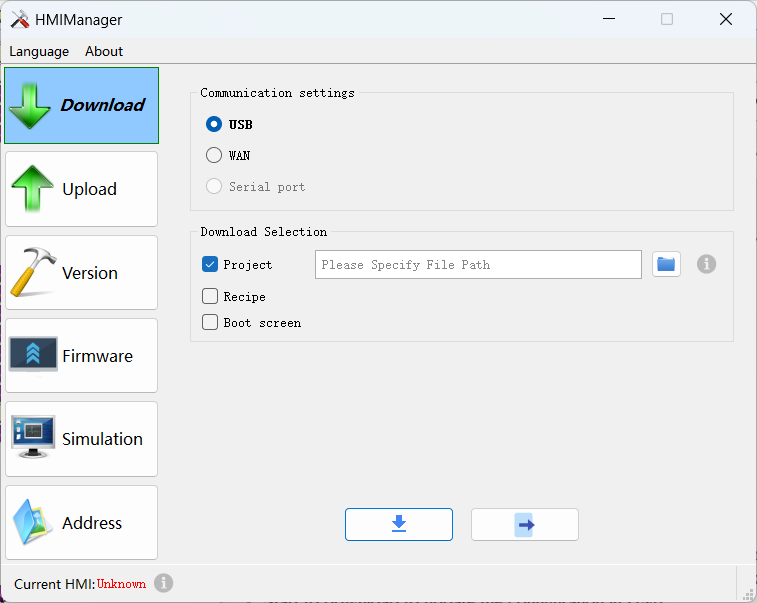
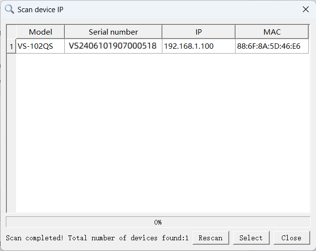
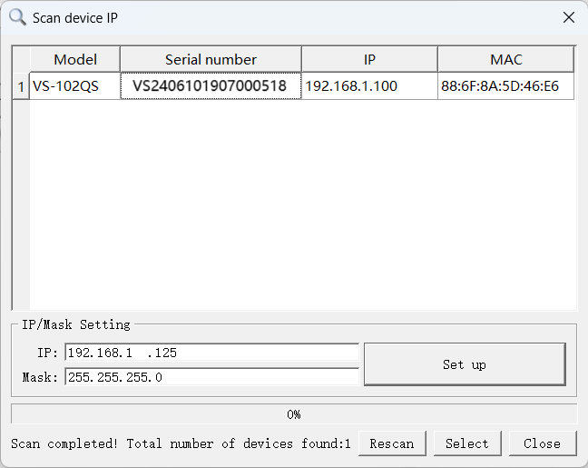
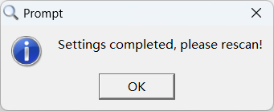
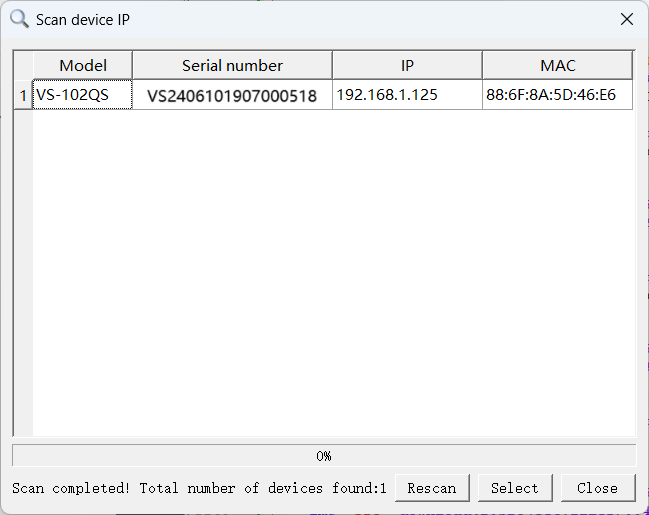
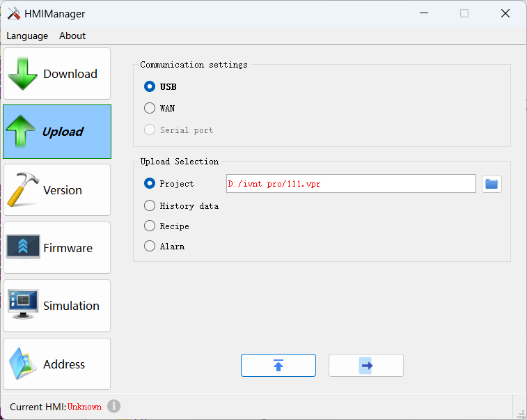
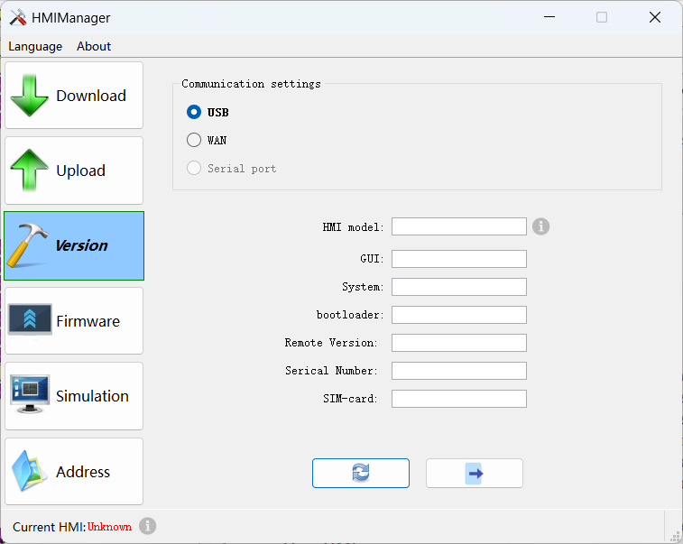
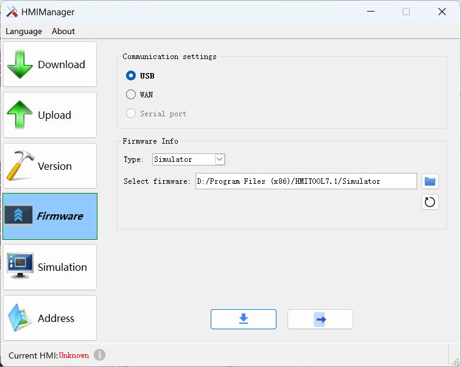
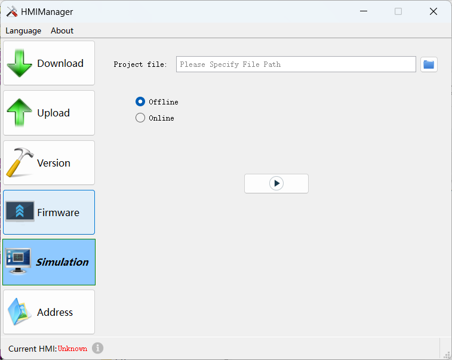
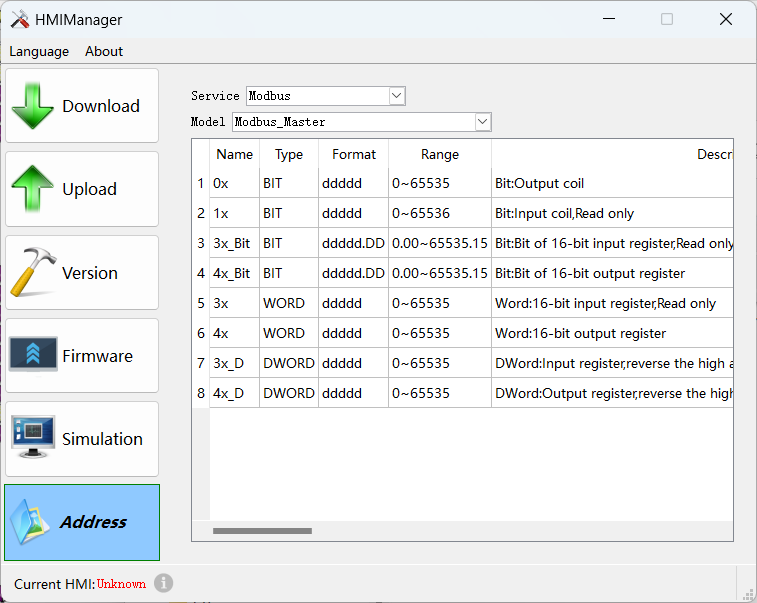

# Use of HMIManager

Go to the Download Tools page

Download Page:

Communication Setting:
USB: PC connects to HMI via USB
WAN: PC connected to HMI via Ethernet

You can also click on the Scan button for IP address scanning

You can check the scanned IP address and modify it in the modification box below

Click the button on the right to make changes to the on-screen information, and a pop-up window will appear when you're done.

At this point, click Rescan, you can see that the modified results have been displayed in the list.

Check the IP address you need to use and click the Select button to complete the selection of the target IP, the IP information will be synchronized to the download window interface.

**Caution!**

When using the IP scanning function, you should ensure that the following three requirements are realized:

1. Touch panels manufactured before December 30, 2024 need to manually update the corresponding IP scanning patch package, if you do not find the "hmi.patch" file in the installation directory, please contact the technical staff to obtain it.
     2. Configuration software version must not be lower than HMITOOLV7.1_022
     3. Firmware version must not be lower than Simulator 8.1.0.10.

Download selection:
Download configuration: you need to generate the configuration project file u-disk-prj.bin, the configuration software selects Download-&gt;Extract Project Save As-&gt;Generate u-disk-prj.bin configuration file, click Browse to select the file, and then click Start to download to update the configuration in HMI.
Download the recipe: compile the edited HMI configuration project, enter the software installation directory under compile, generate recipe60.bin, recipe62.bin two files, lower than or equal to version 6.0 select recipe60.bin file, higher than version 6.0 select recipe62.bin file, click on browse to select the file.Click on Browse to select the file, and then click on Start Download.

Upload Page:

Communication Setting:
Consistent with download processing.

Upload selection:
Upload selection area: touch screen parameter settings are allowed to be uploaded configuration, HMI running program has recipes, historical data, historical alarms exist, otherwise it is impossible to upload the corresponding files
Upload historical data: Click Browse to set the save location and save file name of the uploaded file, click Start Upload to upload the historical data zip file and historical data .csv file, please refer to "Uploading Historical Data Files" for details.
Upload configuration: Click Browse to set the save location and save name of the uploaded file, click Start Upload to upload the zip file of configuration, and then decompress it to view and edit the configuration project file normally, please refer to "Uploading Configuration Program".
Upload Recipe: Click Browse to set the save location and save file name of the uploaded file, click Start Upload to upload the recipe file in HMI.
Upload historical alarms: Click Browse to set the save location and save file name of the uploaded file, and click Start Upload to upload the alarm file in HMI.

Version Page:

Communication Setting:
Consistent with download processing.

Version information: current connected HMI version information.

Firmware Page:

Communication Setting:
Consistent with download processing.

Firmware Info
Firmware Information:Browse to select the firmware that needs to be updated and click Upgrade

Simulation Page:

Browse the selected configuration project file .vpm to perform online simulation and offline simulation.

Address Page:

Service: Choose a different equipment manufacturer.
MOdel: Select the appropriate equipment model
Displays all address information for the currently selected device.
