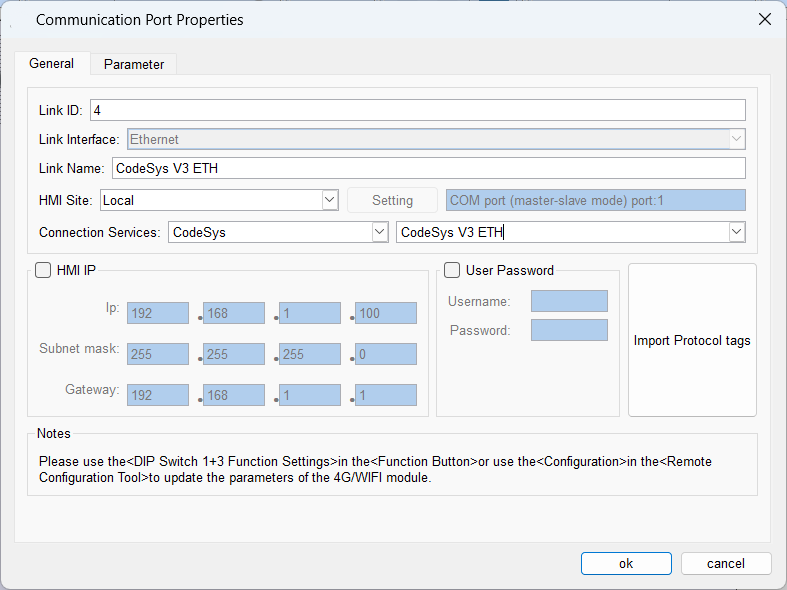
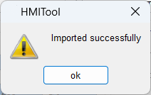
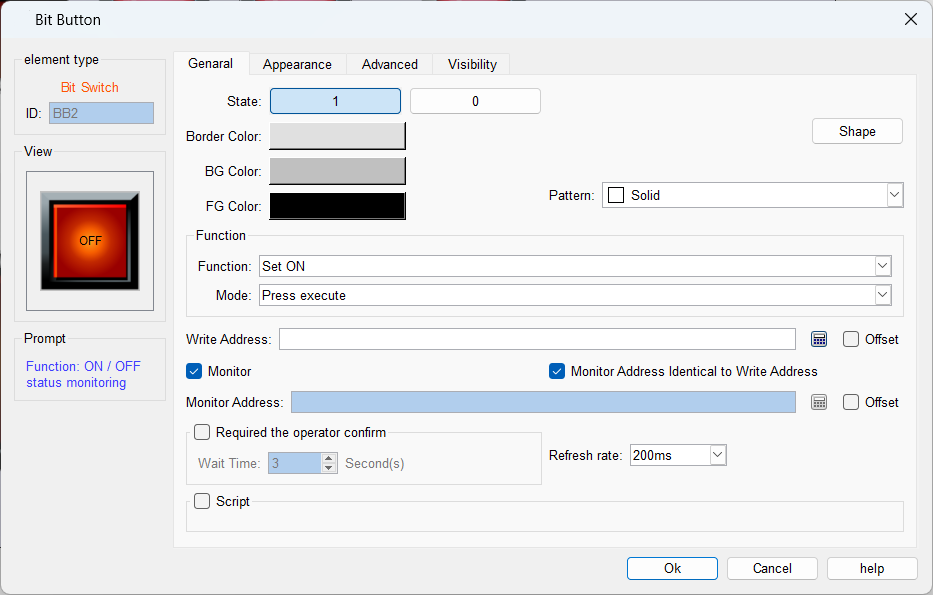
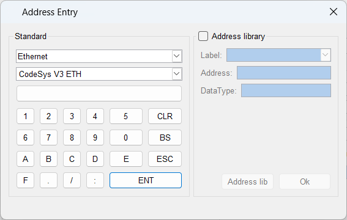
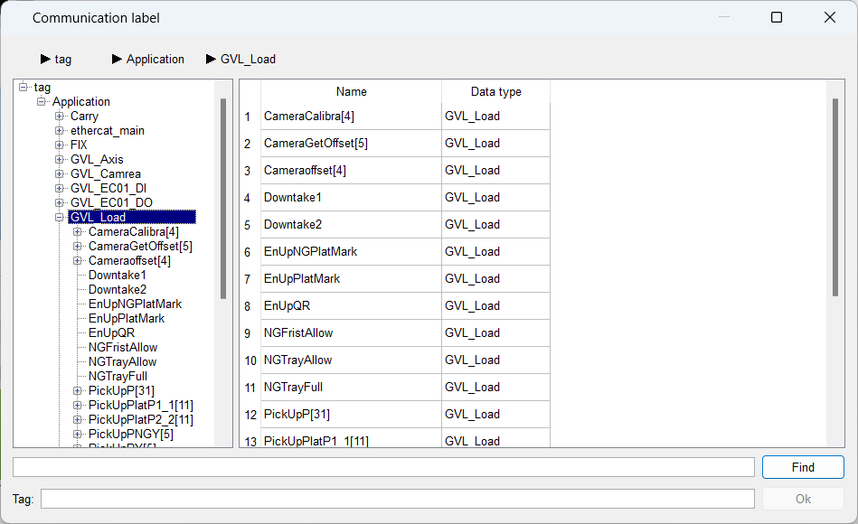
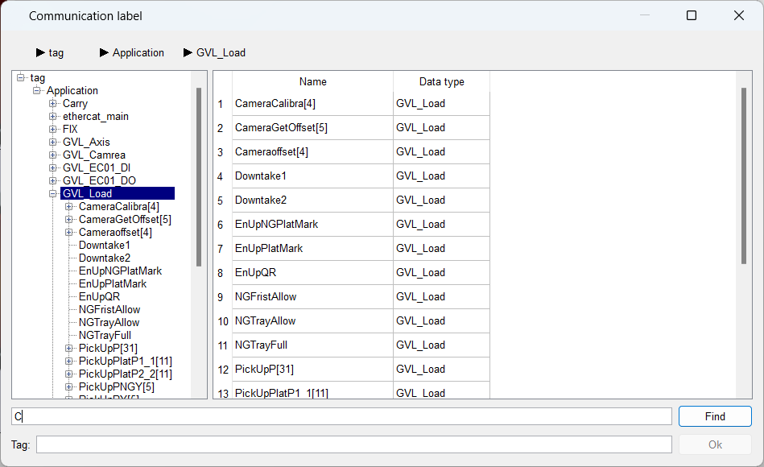
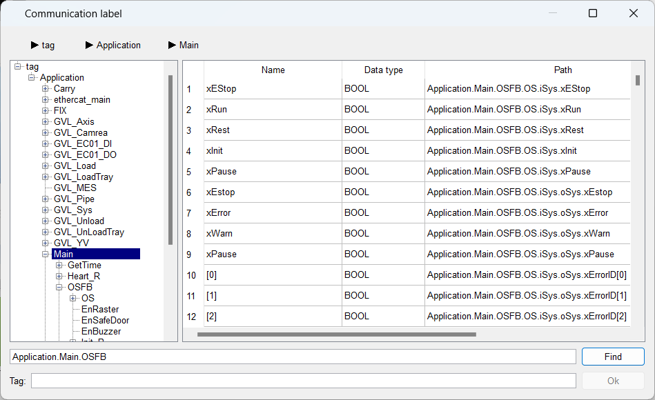

# Newly labeled communication address options

This is an example of connecting "CodeSys V3 ETH" of "CodeSys" to the Ethernet port:
The details page is below:

After importing the communication label, it is displayed as shown in the following figure:

Select a control that needs to write the address, for example, "Bit Switch", click the icon on the right side of the control list, the detail page is as follows:

Click on Address Settings to bring up the address input box, as shown in the following figure:

Click the button below to bring up the Communications tab settings page:

1\. Users can independently change the window size and internal formatting settings, and at the same time, when the window is opened sequentially, the previous user's habits will be retained.
2. The upper part of the new current branch node path display, the user can see the branch of the selected label, but also by clicking on the node for quick jump.

**Find**

There are two types of lookups: general lookups and compound lookups:
**1. General search**
        For example, if you are looking for the letter "C" in a window, it will only display all items containing the letter "C" under the current node "GVL_Load" in the list. In this case, only all items containing the letter "C" under the current node "GVL_Load" will be displayed in the list, including its children and lower grandchildren, and the contents under other nodes will not be searched.

     At this point, clicking on one of the items will not select it immediately, but will go to its sub-items, until the lowest item is selected.

**2. Compound search**
        When you use compound lookup, you can search for strings with struct variables, the but starting at the head of the label and ending with a full dot.
        When performing a search for a structure, you need to write the full path to the structure in the search box. For example, when performing a search in the OSFB directory under Main, you should enter "Application.Main.OSFB" in the search box to locate the current directory, followed by the name of the search item. Double-click to select the label.

