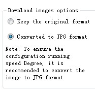

# Picture Format

HM series HMI is compatible with a variety of image formats, such as JPG, BMP, GIF, PNG and so on. However, in order to ensure the display efficiency, the picture format is compressed by default, and also converted into the JPG format (except GIF display control).

  If you want to retain the original format, select HMI parameter settings -&gt; printer downloading settings, and then set the picture option to keep the original format.

Note:

 • Conversion to JPG format is meant to ensure more pictures to be used;

 • Employ of pictures whose resolution does not exceed that of the touch screen can improve the display efficiency;

 • The maximum number of frames for a GIF image is 32.

