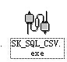

# Export data via U disk

HM series HMI supports exporting historical data, recipes, historical alarms and screenshots via U disk.

Group number is necessary to export historical data resulting from the added function of multiple groups of historical data in the CommandHMI. LW60408 is the group number of the selected history data. For example: Set LW60408 to 1, which means the current historical data for import and export via U diHM is aims at historical data Group 0, instead of others.

Note: If the numerical input value exceeds the maximum group minus 1, this function does not work.

**How to export historical data via U disk**

1\. Insert the USB disk

2\. Set the group number of history data for import and export in the LW60408 register.

3\. Trigger LB60127 to ON and then HMI will copy the history data group file to USB disk, named hisdatai.csv; hisdata1.csv if the group number is 1.

Trigger LB60128 to ON and then HMI will copy the history data group file to USB disk; if you want to import the Group 1, name the file hisdata1.csv.

These triggers are automatically reset to OFF when the export is complete

When exporting local data, employ the LW register: LW60359-LW60429

**How to export formula**

It needs to set LW61143 for formula export operation result from multiple groups of formula in the CommandHMI.

1\. Insert the USB stick.

2\. Set the group number in LW61143.

3\. Trigger LB60163 to ON; HMI will copy the group formula file to U disk

4\. These triggers are automatically reset to OFF when the export is complete

Note: It cannot open directly the historical data exported to the computer, so it needs a data conversion tool, SK_SQL_CSV.exe, which is under the root directory of HM configuration software.

Use this tool to convert the exported file into a CSV file that can be opened directly. Double-click to open the tool.

Progress: The progress of the file conversion.

File name: Select the file to convert.

Select historical data or alarm accordingly. The default encoding is ANSI that cannot be modified. After settings, click "Generate CSV". When the progress bar reaches 100%, the conversion is complete.

**How to get screenshots via U disk**

1\. Insert the USB disk

2\. When configuring, create a Function button -&gt; Screenshot, and select Export to U disk

3\. Touch this function button and then HMI will capture the current screen to the corresponding memory

Note:

 • Do not disconnect the USB diHM during the export operation;

• Maintain the power ON during the export operation;

• Make sure that your USB diHM has enough storage space.

