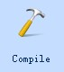

# Update project via U disk

HM series HMI supports importing and updating project via U disk.

**How to update the project file via U disk**

**1. Compile the project**

Run CommandHMI; open the project you want to update; click  to generate the compiled file.

**2. Click "Save Project As" in "Download", then select the save directory**

The file u-disk-prj.bin will be stored in the selected directory.

**3. Copy the compiled file to the USB disk**

Open the directory, copy u-disk-prj.bin to the U disk.

**4. Insert the U diHM to HMI**

**5. Copy the file and re-update the project**

After inserting U diHM into HMI, click YES in the pop-up window to execute the update operation.

**6. Restart HMI to complete updating**

Restart the power supply or restart the HMI by clicking the "Restart" button on the screen.

Note

 • Do not disconnect the USB flash drive during the update process;

• Maintain HMI ON during the update process.

