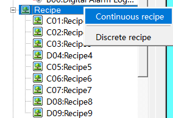
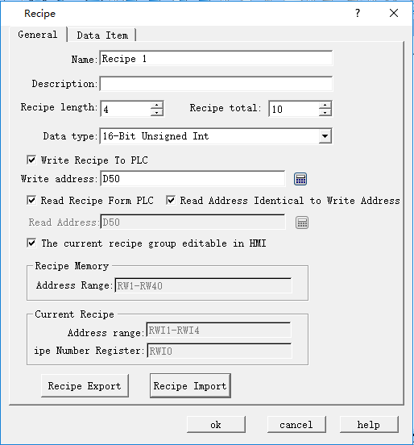
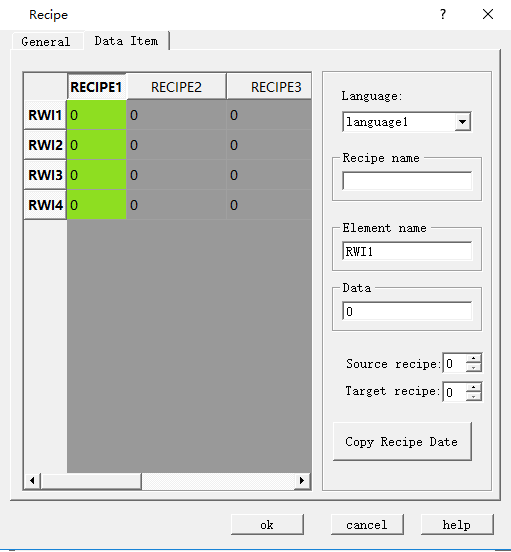
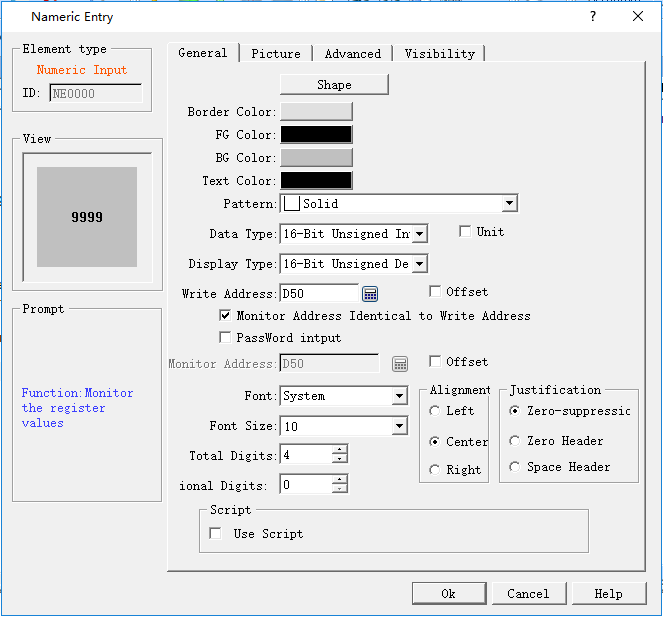
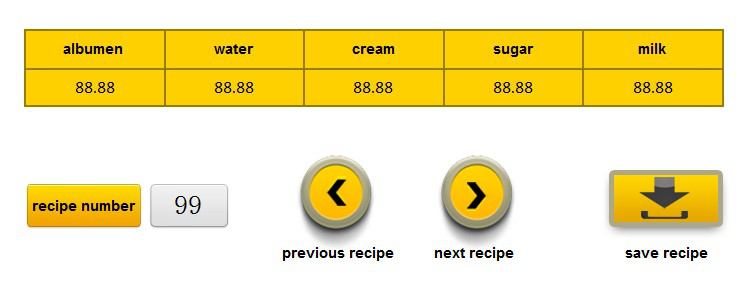

# Recipe Case

The following example shows the settings and display mode of recipe.

1\. **Create a new recipe**

In the project manager, right click on the recipe, as shown in Figure 1:

Figure 11 Create new recipe

Double click to open the recipe, as shown in Figure 2:

Figure 12 General settings of Recipe

Set the recipe length to 4, which means each recipe contains 4 data. The total number is 10, that is, 10 recipes. Set the address for writing recipe to PLC to D50, and select the 16-bit positive integer; write the recipe to the register D50, D51, D52 and D53. Settings are the same as that of the write address.

2\. **Data item setting of Recipe：**

Figure 13 Data item settings of recipe

After setting the recipe name, select "OK" to complete. Employ Numeric Input and Display control to display recipe data on the touch screen. Select the internal memory address RWI0 for the numerical display and input control; serial number of recipe is the value of input and display. The value of RWI 0 stands for the serial number of recipe; value of 2 means serial number of recipe 2, and so on. Employ the Numeric Input and Display control to display data from D50 to D53. You can execute functions of "Function button" for saving or reading a recipe. For details, refer to "Function button".

Figure 14 “Numerical input and display” control for recipe data D50

Set up the Numerical input and display control and place it on the screen：

Figure 15 Screen view of Recipe display

It can change recipe parameters via Numerical input and display; realize functions of checking recipe, reading recipe and writing recipe through function buttons.
