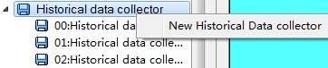
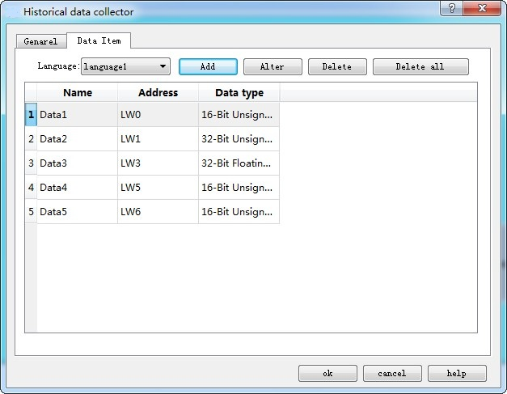
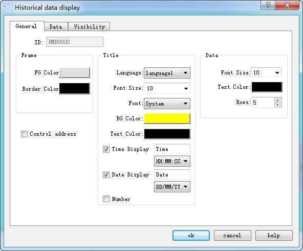
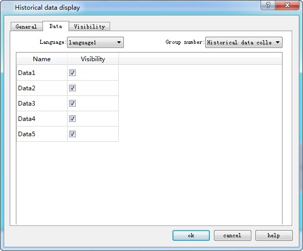
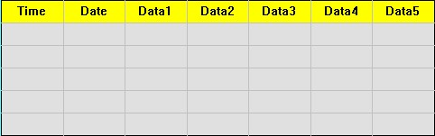
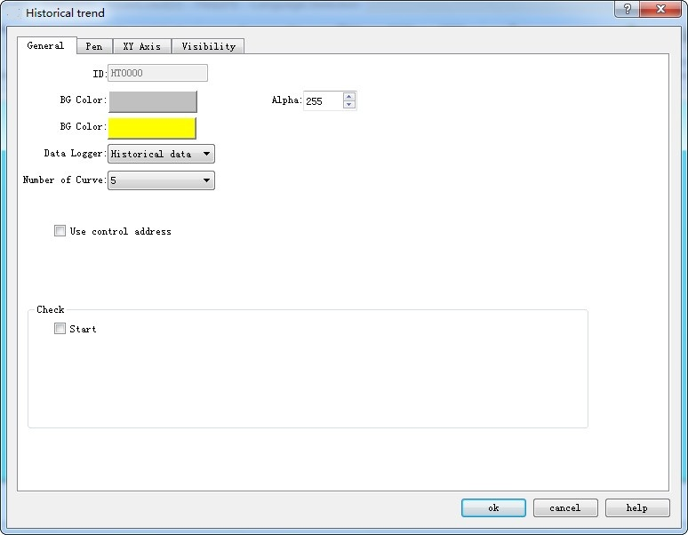
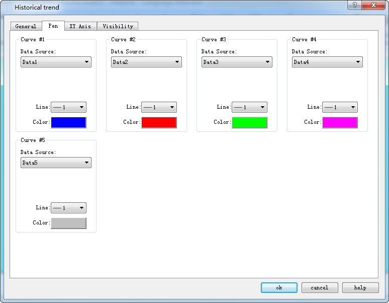
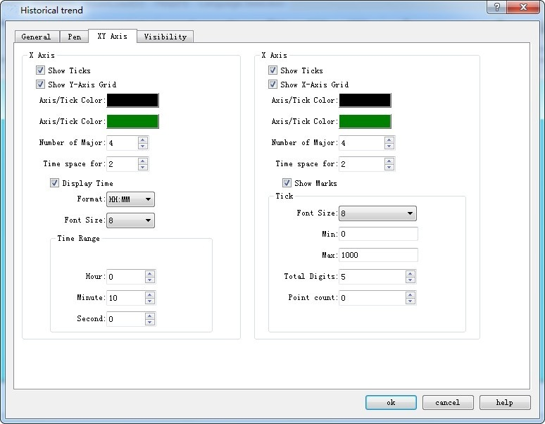
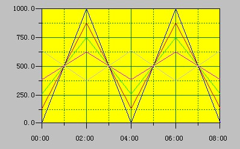

# Historical Data Collector Case

The following example illustrates the combined application of Historical Data Collector, Historical Data Display and Historical Trend Graph.

**1.Create new historical data collector**

Right click the “Historical Data Collector” in the "Project Manager" to create a new one, as shown in Figure 1 below

Figure 1 Create a new historical data collector

**2.Settings of Historical data collector**

Double click to open Historical data collector, as shown in Figure 2

Figure 2 General settings of Historical data collector

Here, we add five data collection items named "Data1", "Data2", "Data3", "Data4" and "Data5" whose addresses are set to "LW0", "LW1" "," LW3 "," LW5 "," LW6 "; set up the data type and name for each, as shown in Figure 3. Since the data 2 and data 3 are 32-bit, it will read the register values of the "LW0", "LW1 + LW2", "LW3 + LW4", "LW5" and "LW6" every time it takes sample. The total sampling here is set to 1000, that is, take a total of 1000 samples, until it is full.

 

Figure 3 Data item setting of Historical Data Collector

Click “OK” button; after settings, execute “Historical data display” if you want to view the historical data.

**3.Settings of Historical data display：**

Figure 4 General settings of Historical data display

Select five for Display lines; Font and Background are up to you.

Figure 5 Data item settings of Historical data display

Check the data to be displayed; click “OK” button to complete; then a table appears on the screen, as shown below:

Figure 6 Historical data display on the screen

Employ “Historical trend chart” to display the value change if it is needed.

**4.Open Historical trend chart, as shown below**

 

Figure 7 General setting of Historical trend chart

**It needs to select the number of line to be displayed and its data source as well as color.**

Figure 8 Line settings of Historical trend chart

**Set the maximum value and time at XY axis.**

Figure 9 XY axis settings of Historical trend chart

**Click “OK” button to complete; draw the trend chart as shown below:**

Figure 10 Historical trend chart display on screen
