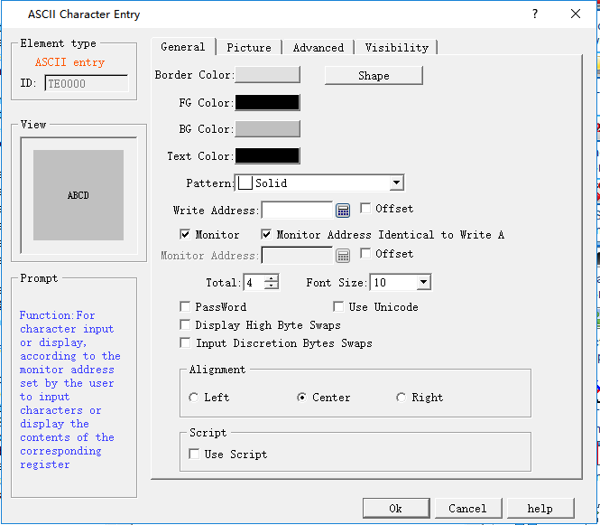

# ASCII Input

Click the ASCII Input button icon, then a dialog box pops up as shown in Figure 4-100:

Figure 4-100 ASCII Input dialog box

• Write address: Input ASCII text into the address.

• Monitor: The address value to be read and displayed by this control.

• Monitor address identical to write address: The monitor address is the same as the write address.

• Monitor address: The address to be read

• Total: The maximum number of characters that can be displayed.

• Font Size: The font size of the character to be displayed

• Exchange high and low bytes of input: The high byte in the value input by user will be exchanged with the low byte, and then the data after such exchange will be stored into the monitored word address.

• Password: When this is selected, the control does not show specific characters but displays an asterisk (\*)

• Use UNICODE: The monitor address value is displayed in Unicode encoding

Alignment:

• Left: The character displayed is in the left part of the display area.

• Center: The character displayed is at the center of the display area.

• Right: The character displayed is in the right part of the display area.

• Use Macro: Select the option of "Use Macro" to display a list of macros. User can select one to execute when the button is pressed. Only compiled macros are displayed in the drop-down list.

Note: For example, when the 32-bit data type is selected, the stored address occupies 2 words. For example, when writting data to the SIEMENS PLC's data register, and the address written is V10 , then the occupied data register address includes V10 and V11; if users also use other controls to monitor the value of V11, an error will appear. Users should pay attention to the use of 32-bit data types in case of Note data and address errors.

Note: Other functions in General page are the same with those of SCII Display which you can refer to.

Note: Refer to Bit Button for the application of “Advanced” and “Visibility” page.
