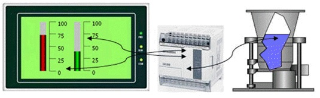
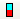
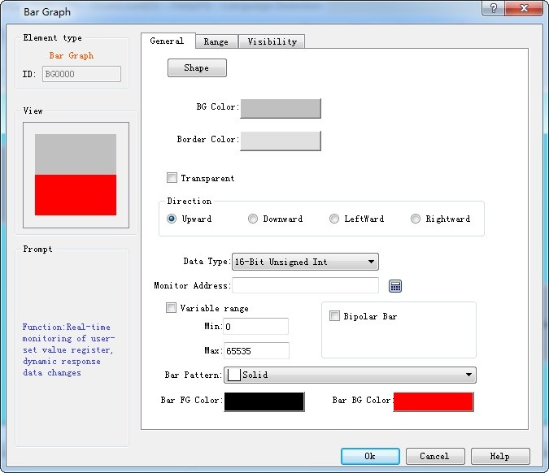
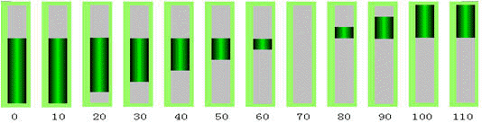

# Bar Graph

Graph, also called bar graph, is mainly used to present the real-time change in the numerical values in the form of bars, so that user may view such change more visually. Graph may present the change in the numerical values of data registers of PLC or other devices connected, and also the real-time change in all analog quantities in process flows. See the figure below.

Figure 4-101   bar graph

Operations of adding a histogram (bar) and modifying the properties are as follows:

1\. Select the Bar Chart icon in the toolbar or the Tools menu. Then it appears a dialog box shown in Figure 4-102.

2\. Set the properties of the bar graph in the Property dialog box, and then click OK:

• Background color: The background color of the bar chart

• Border Color: Set the border color of the bar. In Figure 4-102, the setting of border color is invalid; user can select the "shape" in another bar; the change is visible.

• Transparent: Set the background of the bar to be transparent

• Direction: The direction of the histogram scroll, there are four directions: Upward, Downward, Leftward and Rightward.

• Upward: When the value of the monitor address increases, the columnar surface rolls from bottom to top

• Downward: When the value of the monitor address increases, the column rolls from top to bottom

• Leftward: When the value of the monitoring address increases, the columnar surface rolls from right to left

• Rightward: When the value of the monitor address is increased, the columnar surface rolls from left to right

• Data type: The data type of the read address value, ie word address or double word address.

• Monitor address: The data register address that can be displayed in the bar, ie, the read address

• Maximum: The maximum value of the Monitor (read) address. When the value of the monitor (read) address is greater than it, the bar is full and no longer changes with the value of the monitor address

• Minimum: The minimum value of the Monitor (read) address. When the value of the monitor (read) address is less than this value, the bar is empty and no longer changes with the value of the monitor address

• Variable range: The maximum and minimum values are dynamically changed, depending on the address entered by the user; the data type of the address is the same as the set "Data type”

• Bipolar bar: It can be displayed on both sides according to the value of the data register.

• Midpoint: The midpoint of the bipolar bar.

Figure 4-102   Bar chart dialog box

For example, assuming the maximum value is 100, the minimum is 10, and the scroll mode is upward, when the bipolar bar is selected, input 70 to the "Midpoint" value. Then the value incremented of the monitor address from 0 is shown in Figure 4-103.

Figure 4-103 bipolar bar graph

3\. Modify the bar chart: Click on the histogram, then it will appear eight small green dots that you can drag with the mouse to modify its size.

“Range” page:

This page is mainly used to display the value of the monitor address in the specified range to show a different foreground color and background color. The properties are shown in Figure 4-104:

Figure 4-104   Bar Graph Range page

• Display Range: When this option is selected, user can set the lower and higher limit values as well as the low and high-level background color according to the needs. The address value monitored (read) by the control will be represented by different color patterns in the user-set lower and higher limit values.

• Variable range: the values of "Lower Limit" and "Higher Limit" are dynamically changed, depending on the address entered by the user

• Lower limit: Set the lower limit of the display. When the number displayed is lower than this limit, the background color will be the color set in Low Level Background Color.

• Higher limit: Set the higher limit of the display. When the number displayed is higher than this limit, the background color will be the color set in High Level Background Color.

After the settings, click "OK" to add the control to the view area (the screen)

Note: If the value of the monitor address is between the maximum and the minimum, the foreground and background color is identical to the settings in “General” page.

Note: Refer to “Bit button” for the application of “Visibility”.
