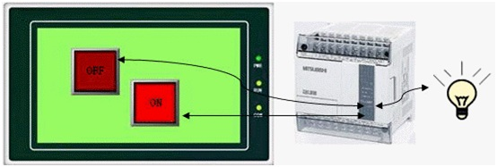

# Bit Lamp

The Bit Lamp can be used to monitor the ON / OFF status of bit contact of the connected device and to display it on the HMI scree.

As shown in Figure 4-78 below:

Figure 4-78

Set up a Bit Lamp:

1\. Select the Bit Lamp button icon on the toolbar: The dialog box shown in Figure 4-79 will pop up:

Figure 4-79    Bit Lamp dialog box

• Data Type: The drop-down box has three options, namely: Bit, Word Bit and Double-word Bit. If select "Bit", the Monitor (read) address is Double-word Bit means a double word address.

• Bit Number: When the chosen data type is "Word Bit" or "Double-word Bit", the value of the monitor address (status of ON/OFF) is determined by the bit number value. It is from 0 to 15 for Word Bit and 0 to 31 for Double-word Bit.

For example, when "Word Bit" is selected, the monitor address is LW1 with a value of 23, if the bit number is 3, the state of this address value is 0 because the binary number of 23 is 10111 whose 3rd number from right to left is 0.

Note: Refer to Bit Button control for Shape, Border color, Foreground color, Background color and Pattern.

2\. In the "General" Property dialog box of the bit lamp, choose an address to be monitored by this indicator. Through the settings in “Mark”, you can set contents and pictures to be displayed and also choose whether to blink.

Note: The "Mark" page of the "Bit Lamp" is the same as that of the "Bit Button" which you can refer to.

3\. To reset the properties of this indicator, double-click it to reset it in the property dialog box.

Note: The Visibility page of the Bit Lamp is the same as that of the Bit Button control that you can refer to.

After the properties set up, click "OK" to add the control in the view area (i.e., the screen)
