# Bit Button

Bit button is used to operate and display the ON/OFF status or 1/0 status of the bit address of the device connected with the touch screen. Bit button is the most fundamental and frequently used control.

Steps to set a Bit button:

1\. Click the Bit Button iconon the toolbar to bring up a dialog box, which is for setting the properties of Bit Button, as shown in Figure 4-68:

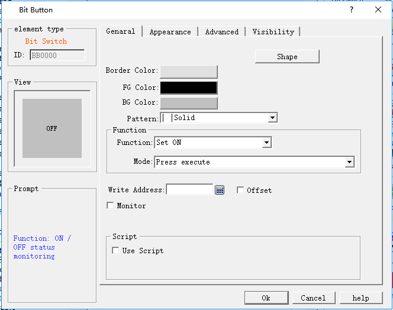

Figure 4-68 Bit Button dialog box

2\. The dialog box includes four items, that is, General, Mark, Advanced and Visibility.

Shape: Click the Shape button to select a shape for the control graph, as shown in Figure 4-69

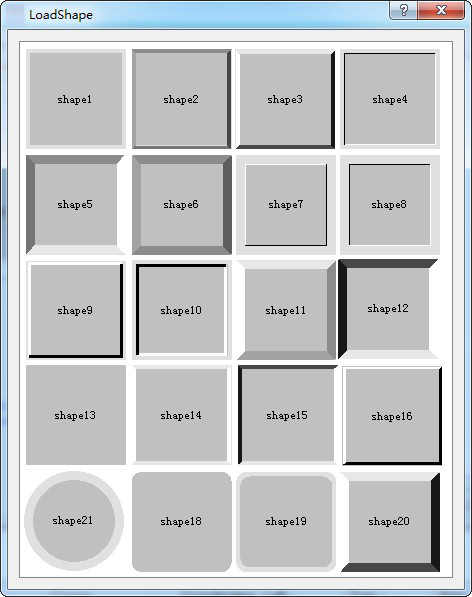

Figure 4-69 Shape pop-up dialog

• Border Color: When having chosen a shape with border, click this button to select a different color for the border.

• Foreground Color: When it needs to change the foreground color, click this button to choose a different foreground color on the drop-down color selection box. (Foreground color works only if the transition style is selected).

• Background Color: When it needs to change the background color, click the button to select on the drop-down color selection box.

• Pattern: Click the drop-down box, which contains a total of 21 kinds of patterns as shown in Figure 4-70:

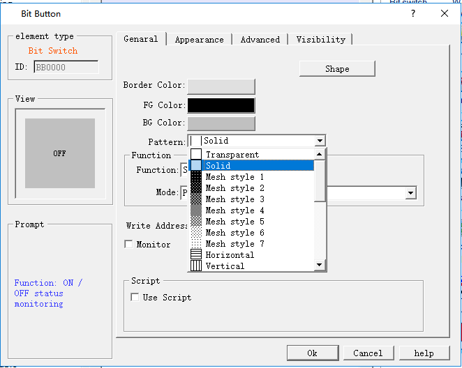

Figure 4-70 Change shape and pattern value

• Set: If Set function is chosen, after the downloading to HMI, the value of the write-in address may be set to 1 by clicking the bit button. In other words, the write-in address of the device connected will be set to ON status, and the status of 1/ON will be displayed.

• Reset: If Reset function is chosen, after downloading to HMI, the value of the write-in address may be set to 0 by clicking the bit button. In other words, the write-in address of the device connected will be set to OFF status, and the status of 0/OFF will be displayed.

• Inching: If Inching function is chosen, either “pressing down being 1” or “pressing down being 0” may be chosen. When “pressing down being 1” is chosen, after downloading to HMI, the value of the write-in address of the device connected is set to 1/ON when the bit button is pressed down, and the status of 1/ON will be displayed; meanwhile, the value of the write-in address of the device connected is set to 0/OFF when the bit button is released, and the status of 0/OFF will be displayed. When “pressing down being 0” is chosen, after download to HMI, the value of the write-in address of the device connected is set to 0/OFF when the bit button is pressed down, and the status of 0/OFF will be displayed; Meanwhile, the value of the write-in address of the device connected is set to 1/ON when the bit button is released, and the status of 1/ON will be displayed.

• Alternate: When Alternate function is chosen, after the downloading to HMI, if the current status of the bit button is 0/OFF, the value of the write-in address will be set to 1/ON when the bit button is touched, and the status of 1/ON will be displayed; If the current status of the bit button is 1/ON, the value of the write-in address will be set to 0/OFF when the bit button is touched, and the status of 0/OFF will be displayed. The status changes with the times of touching.

• Write Address: Click the Keyboard button icon after "Write Address" to enter the address. CommandHMI software will distribute corresponding address symbols according to different connected devices. For example, in FX-2N series of MITSUBISHI (Mitsubishi) PLC, X represents the address of input coil; Y represents that of the output coil; M that of the intermediate relay; C that of the counter (switch status display); T that of the timer (switch Status display); D that of the data register; C \* that of the counter (count value); T \* represents that of the timer (count value). Another example is the series of SIEMENS (Siemens) S7-200: I represents the input address; Q on behalf of the output address; M on behalf of the intermediate relay address; V on behalf of the data register address. As shown in Figure 4-71:

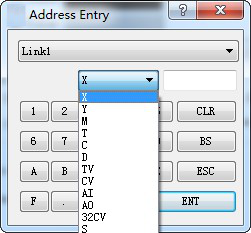

Figure 4-71 Input address

So that engineers can write the current status of this bit button to the address using a different address symbol for PLC or other connected devices. The value of the write address or display address is 0 / OFF when the bit button is in the 0 / OFF state; and the value of the write or display address is 1 / ON when the control is in the state of 1 / ON.

• Monitor: Select "Monitor" to display the "Monitor Address”, indicating that the "bit button" can be used to monitor the value change of "Monitor Address". The value of the Monitor address is 0 / OFF when the bit button is in the 0 / OFF state; and the value of the Monitor address is 1 / ON when the control is in the state of 1 / ON. When "Monitor Address" is chosen, the monitor address and write address can be different. For example, when it selects the Set function, touching this control makes set the write address to 1 / ON; but if the monitor address is at 0 / OFF at this time, the bit button will still display 0 / OFF state. Generally, users choose "Monitor address identical to Write address" in order to reflect or display directly the state value you write.

• Macro: Chosen "Use Macro", then it will display a list of macros. User can select a macro to execute when press the bit button. Only compiled macros are displayed in the drop-down list.

When Monitor isn’t chosen, the button switch state will not change even if the control is touched.

**Mark**

When select the Mark tab, the property of Status 0 Text is displayed, as shown in Figure 4-72:

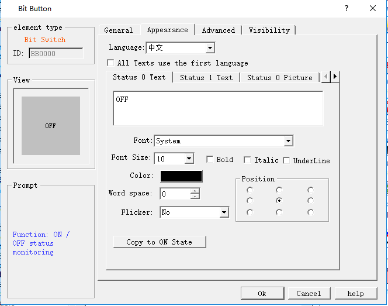

Figure 4-72 Bit Button Label page

The page also has four items, "Status 0 Text", "Status 1 Text", "Status 0 Picture" and "Status 1 Picture".

• Status 0 Text, Status 1 Text: Used to change the font, font size, margin, font color, and position of the state 0 or state 1 text. CommandHMI also provides the copying function, enabling copy one’s attributes to another’s, which is convenient and timesaving.

• All Texts use the first language: This option is used when it comes to multiple languages ("Language" in the Project Manager). When the total number of languages is greater than 1, you can select this option to make sure that the contents of this control will not switch with the languages.

• Language: This option is used when it comes to multiple languages. Input contents with a different language for multiple languages.(In the Function button, select the 'Switch language' option and which one to switch to; then in the simulation or on the HMI screen, all the controls with text will be presented by the selected language). For different languages, the text content, font and font size can be different, but the color, kerning and position are the same

• Font: Choose the type of text for the text; different languages can choose different fonts.

• Font Size: Choose the font size for the text content; different languages can choose different font sizes..

• Color, Margin, Position: Set the color, Margin, and alignment of the text selected current. When it has more than one language, these options are the same to that of the language 1, and they are invalid in the language setting of others.

• Status 0 Picture, Status 1 Picture: You can add different formats of picture for different states according to various "Picture source". When a picture is chosen, it will be automatically added to the "General" page. If “Fit to Object Size” is selected, the selected image will be the same size as the control.

• Fit to Object Size: If “Fit to Object Size” is selected, the selected image will be the same size as the control; and the Margin and Position options are hidden.

• If you import a picture from an external file, the "Transparency" option appears to make a specified color transparent

When “Flicker” is chosen, the flashing screen is on the ON / OFF status. The default flashing frequency is 1s. If you want to change the frequency, you can double-click the "Project Manager" in the "HMI parameter settings". Select the "Flashing frequency" to change it.

Select the "Advanced" page to display the "Advanced" properties, as shown in Figure 4-73

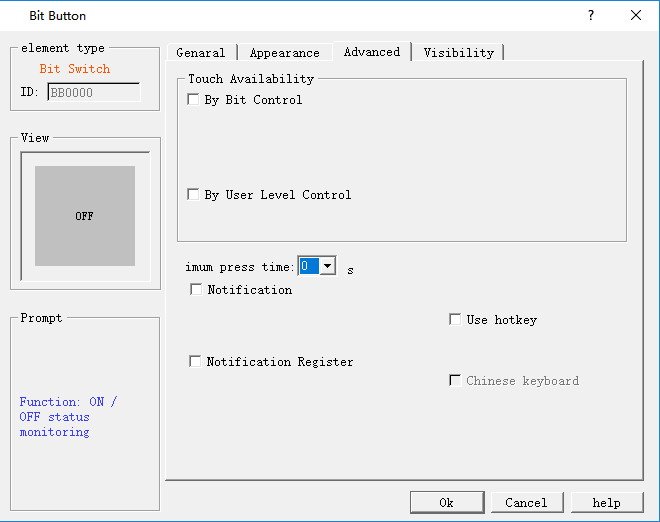

Figure 4-73  Bit Button Advanced page

• Controlled by Bit: "Controlled by Bit" having been chosen, when the "Valid Status" selected is 1, the "Bit Button" can be effectively touched if and only if the value of the "Control Bit" is 1. When the selected "Valid Status" is 0, the "Bit Button" can only be effective if and only if the value of the "Control Bit" is set to 0. Otherwise, the "Bit Button" cannot function no matter how.

• Controlled by User Level: User can select multiple options as needed. After setting, in the simulation or on the HMI screen, the current user is checked whether this user lever has the permission.

For example, if option 2 and 3 are chosen in the Effective Level Controlled in the Advanced Page of the control, and the User Password Setting in the Touch Screen Parameter Setting is as shown in Figure 4-74：

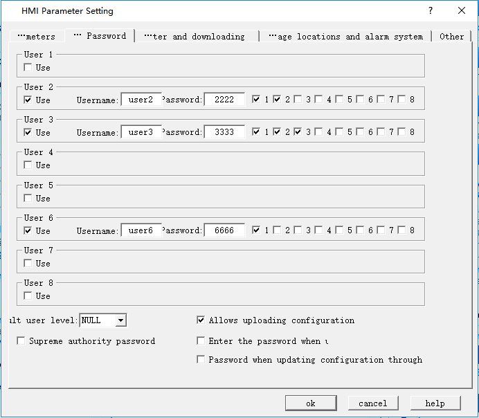

Figure 4-74 User Password Setting in the touch screen parameter setting

If Default User Level is NULL, this control is not touchable, and in this case you can use Change User Level in Function buttons to change the default level. For example, if the password entered by the user is 6666, corresponding to User Level 6, but the user chooses only option 1, not matching option 2 or 3, so the system will prompt that the password is incorrect; When the password entered by the user is 2222 or 3333, as both users have option 2, matching option 2 or 3, the password is valid and this control will be changed to a touchable control. If the Default User Level is user 2 to 3, then both user levels have option 2 to match the touching conditions, and then this control is touchable in simulation or initialized screen; If the Default User Level is user 6, then this user level does not have an option to match the touching conditions, and then this control is not touchable in simulation or initialized screen. The default setting is as shown in figure below:

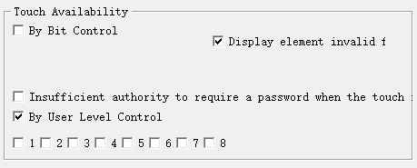

If select “change the user level is insufficient”, when the user level is not matched, a login interface will pop up so that user can select a matching level and log in again, as shown below:

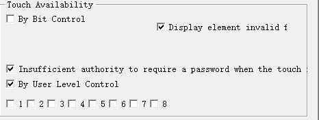

In CommandHMI software, only bit button, drop-down box, ASCII input, function button, ASCII keyboard input, multi-function button, multi-state button, formula selection, screen button, radio button, step button, word button, slider and numeric input controls have this function, and as for their application, it can refer to that of bit button.

• Minimum press time: How many seconds it needs to react after the press in the simulation or on the HMI screen.

• Notification: In the case of that the control can be touched in the simulation or on the HMI screen, click on the control, and enter a value with the pop-up input keyboard; then the state value will be written to the set "Notification Bit" address (1 or 0).

• Notification Register: In the case of that the control can be touched in the simulation or on HMI screen, click on the control, and input a value through the pop-up input keyboard, then the value will be written to the set "notification register address" ( i.e. the value input by user).

• Hotkey: When this function is selected, you can enter a number or character to achieve the same effect as that of pressing, For example, if input 1, click the numeric keypad 1in the simulation or on HMI screen, or through an external keyboard, it functions similarly.

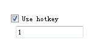

The default user level is NULL, which is the lowest level. Engineering designers can change the it by selecting the "Change User Level" function in the function button and entering the corresponding password.

Effective touch means actual effect generates when the control is touched, such as the success of the set, reset, inching, alternation. Another example is the numeric input. When user touches the numeric input button, the keyboard will pop up. Meanwhile the numeric input button will not generate a notification effect, since this operation is not written to the address. If you press ESC to exit the keyboard will not produce notice. It is valid only when you enter a numeric value between the maximum and minimum values on the keyboard and press the ENTER key, then a notification will arise.

Select the "Show" page to display the "Show" property, which is used to set whether the control is displayed or hidden. As shown in Figure 4-75

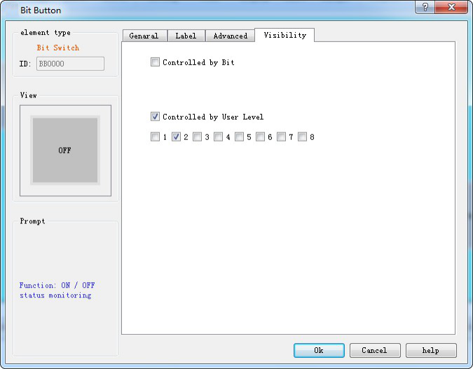

Figure 4-75 Bit Button Visibility page

• Controlled by bit: When this option is checked, if the Effective State is 1, then the Bit Button can be displayed on the touch screen when and only when the value of the Control Bit is 1; If the Effective State is 0, then the Bit Button can be displayed on the touch screen when and only when the value of the Control Bit is 0.

• Controlled by User Level: When User Level Controlled is chosen, the conditions will be the same as those in the User Level Controlled option in Advanced page, and only when such conditions are met the Bit Button can be displayed on the touch screen.

If neither of these two options is checked, the control will be always displayed on the touch screen.
