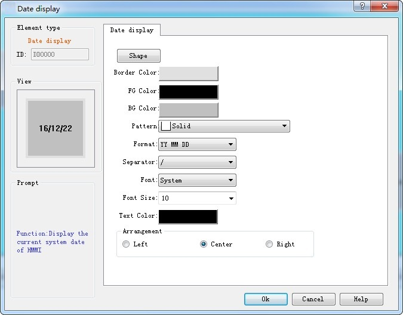

# Date Display

The control of Date Display is mainly used to display the system date. Click in the button icon  in the toolbar, then it will appear a dialog box as shown in Figure 4-106:

Figure 4-106   Date Display dialog box

• Format: There are nine modes of date display for user’s choice.

YYYY-MM-DD

MM-DD-YYYY

DD-MM-YYYY

YYYY/MM/DD

MM/DD/YYYY

DD/MM/YYYY

YYYY.MM.DD

MM.DD.YYYY

DD.MM.YYYY

• Font: Font type of text

• Font Size: Decide the font size of time display

• Color: Decide the text color of time display

• Alignment: Decide the position of time display, left, center or right.

After the settings, click "OK" to add the control to the view area (the screen)

Note: Refer to Bit Button control for Shape, Border color, Foreground color, Background color and Pattern.
