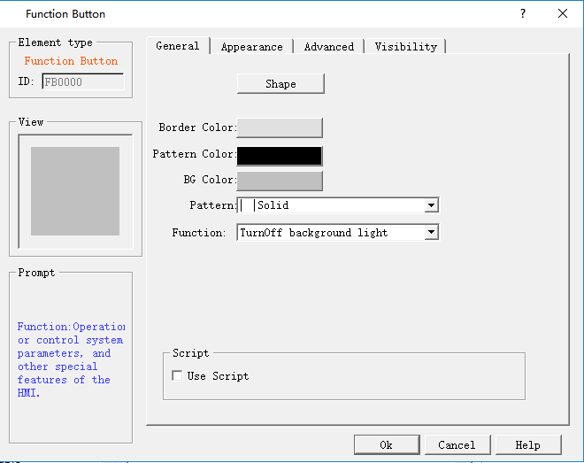

# Function Button

Function Button is an essential control in HMI; with the Function button you can achieve a variety of functions easily and quickly. Click  to open the property dialog box of Function Button, as shown in Figure 4-82:

Figure 4-82 Function Button dialog box

Note: Refer to Bit Button control for Shape, Border color, Foreground color, Background color and Pattern.

**1. Turn off Background light**

Choose the function of Turn off the background light. Then click the button on the screen to turn off it while HMI will still works properly. To turn on the backlight, simply touch anywhere on the touch screen.

**2. Confirm Alarm**

Choose the function of Confirm the alarm. Then you can confirm the selected alarm by clicking the button

**3. Restart**

If the function button is set to System Restart, then the touch screen will be restarted by touching this button.

**4. Set screen saver timeout**

If the function button is set to Set Screen Saver Timeout, then a window will pop up for setting of screen saver timeout after touching this button.

**5. Write recipe to the PLC**

Choose this function to transmit recipe to the PLC. Click this button on the touch screen to transmit the recipe saved in the current HMI to the PLC or corresponding continuous data register of other connected devices. (The address is the write address set by engineers when set up a recipe with the software.)

**6. Read recipe from the PLC**

Choose this function to read recipe from the PLC. Click this button on the touch screen to read the recipe data from the PLC or corresponding continuous data register of other connected devices. (The address is the write address set by engineers when set up a recipe with the software.)

**7. Set the date and time**

Choose this function to set the time and date; click the button on the touch screen to set the inner time and date.

**8. Clear Alarm**

Choose this function to clear the alarm; click the button on the touch screen to clear the selected and confirmed alarm.

**9. Previous recipe**

Choose this function of the Previous Recipe to open the previous recipe of the current one after clicking this button. If the current recipe is the first one or the total number of recipe is 1, this operation does not change recipe parameters.

**10. The latter recipe**

Choose this function of the Latter Recipe to open the latter recipe of the current one after clicking this button. If the current recipe is the last one or the total number of recipe is 1, this operation does not change recipe parameters.

**11. Save the current recipe**

Choose this function for saving the current recipe by clicking the button on the touch screen to save the recipe data from corresponding continuous data register of the PLC or other connected device, which is set when engineers set up the recipe with the software.

**12. Screenshots**

Set the function button function as Screenshot; click this button to intercept the current screen as a picture saved in the user-specified location. The address of Picture name can be input using ASCII Input, the Picture name cannot consist of ：#￥%&\*-+&lt;&gt; etc. And the length of the name must be 20 or shorter than 20.

**13. System parameters**

Set the system parameter of the function button. Click it on HMI to open the system parameter setting screen where you can modify settings, such as system time, screen saver time, background light contrast and so on.

**14. Log on**

Choose the function of Log on, then when user clicks this button, a login interface will pop up. After choosing the User Name, a keyboard will pop up with which user inputs a password to achieve an access permission.

**15. Cancel user login**

Choose the function of cancel a user's login; click this button on the touch screen to log out and cancel the current user's privilege so that the user's level becomes the lowest.

**16. Alarm Sound (ON / OFF)**

Choose the function of Alarm Sound ON / OFF to make a sound when it occurs an alarm. You can set the function button to enable or disable this function. If the current state is on, the alarm sound will be shielded after user clicking this button, and vice versa

**17. Touch sound (ON / OFF)**

Set the function button to Touch Sound Switch, then the touch sound may be turned on/off by touching this button. If there is touch sound at present, the touch sound will be turned off after touching this button, and vice versa.

**18. Clear all historical data**

The history data stored in HMI will be cleared.

**19. Clear the historical alarm**

The history alarm saved in HMI is cleared.

**20. HMI protection unlock**

Enter the password to deactivate the HMI protection.

**21. Recipe Read & Save**

Read and save the recipe.

**22. Alternate function**

Only as back-up function, it does not perform any operation.

**23. Reload recipe**

Reload the recipe data in flash to the corresponding RWI address.

**24. Switch languages**

Switch text contents of all the controls to that of another specified language

**25. Print Screen via a serial printer**

Print the set screen through a serial printer. Connection setting of the printer driver is under the "HMI Parameter settings" -&gt; "Printer and Download settings", in the left frame of the software interface.

**26.Slave devices IP config**

This function requires the "Extended Mode" that can be set in the "Communication Port Property". The application of Ethernet communications for multi-machine needs to add a station number and the register address controlling the station number in front of the corresponding control. When the project in HMI is running, click on the function control, and  the station number set by user will be shown in the " IP config "dialog box; then set the corresponding IP parameters of station number to achieve multi-machine Ethernet communication.

**27. Function set of DIP switch 1 and 3**

Functions of DIP switch 1 and 3 on the hardware when they are in ON state, mainly consisting of IP setting, system time setting and backlight parameters. After the setting, click OK to restart.

Use Macro: Selecting "Use macro" will bring up a list of macros and users can choose one to execute when the function is executed. Only compiled macros are displayed in the drop-down list.

Note: After jumping to the system screen, the system will close the current project; when return from the system screen, it will restart the project, and enter the start screen of project settings.

Note: The "Mark" page of Function button is similar to that of the "Bit Button" control which you can refer to. Except that the Mark page of Function button has no Status Text 1 neither Status Picture 1 because it has only one state.

Note: The Advanced and Visibility pages of the Function Button are the same as that of the Bit Button control. You can refer to the Bit Button control and refer to Bit Switch for the use of hotkey.

Note: Operations of Previous recipe, later recipe, save recipe, read & save recipe are only valid to the current recipe group. If you still want to operate, set the LW61141 group then.

Note: Clear history data means all historical data groups are cleared.

After setting all the properties, click "OK" to add the control button to the view area (i.e., the screen)
