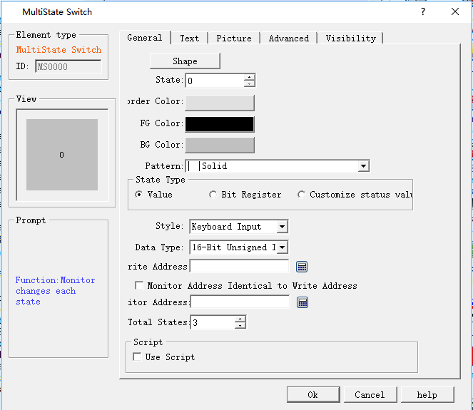
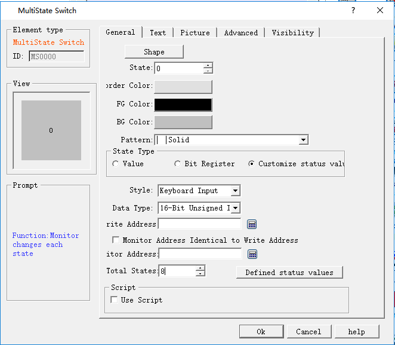
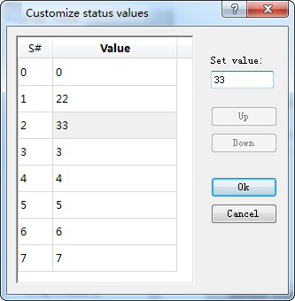
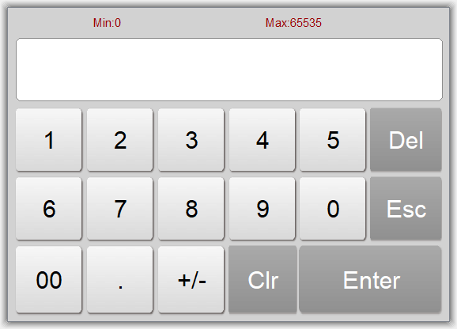

# Multi-state Button

Functions between Multi-state button and Multi-state indicator lamp are basically the same, while the only difference is that multi-state button supports value input, rather than simple function of indicating. Specific operation is as follows:

Click the button iconon the toolbar to display the dialog box shown in Figure 4-87.

Figure 4-87 Multi-state button dialog box

• State: User can change the state value, as well as the border color, foreground color, background color and pattern of the control in different states

• State type: (assuming the input value is n)

• Value: The value written is a number from zero to the total number of states.

• Register bit: the value written is nth power of 2.

E.g:

Select “Value” for State Type, “Keyboard Input” for Mode and LW3 for Write Address and select the option of "Monitor Address Identical to Write Address”, the total number of states 8. After that, click OK to add the control to the screen, then save the project.

In the simulation or screen, click on the control, and then an input keyboard pops up where user can enter a state value. Assuming that the input value is 3, then the value written to the register LW3 is the 3rd power of 2, which shows the text in the state 3 (the text in state 3 of this control in the Text page). Conversely, when the value entered for the LW3 address is 8, the control displays the text content of the state 3. When the value of the LW3 address input is 5, the control does not display any status.

• Customize Status Value: When select this option, a "Define Status Value..." button appears, as shown in Figure 4-88:

Figure 4-88 Multi-state button select Customize Status Value

Click "Define status value..." button, it will pop up a "Customize status value" dialog interface, as shown in Figure 4-89:

Figure 4-89 Define status value dialog box

In this dialog box, the "S #" column is the current status column. After selecting a row, the corresponding value to “S#” in that row indicates the current status value; double-click to enter the value in the current state.

For example, Select “Customize status value” for State Type, “Keyboard Input” for Mode, and LW3 for Write Address and select the option of "Monitor Address Identical to Write Address”, the total number of states is 8. After that, click OK to add the control to the screen, then save the project. In the simulation or screen, click on the control, and then an input keyboard pops up where user can enter a state value. Assuming that the input value is 1, then the value written to the register LW3 is 22, which shows the text in the state 1 (the text in state 1 of this control in the Text page). Conversely, when the value entered for the LW3 address is 33, the control displays the text content of the state 2. When the value of the LW3 address input is 2, the control does not display any status.

• Mode: Provide six function options: "Keyboard Input", "Output constant", "Increase", “Decrease", "Loopback increase " and "Loopback decrease ".

• Keyboard input: Three options in the "State Type" can be selected. In the simulation or screen, when click the control, it will pop up a keyboard for user to enter the value, as shown in Figure 4-90:

Figure 4-90 Keyboard

• Output constant: Only the "Value" option can be selected among the three function options in the "State Type". After selecting this option, a “constant” box will show for constant setting. In the simulation or screen, if click on the control, the value written is the set constant value

• Increase: Only the "Value" option can be selected among the three function options in the "State Type". In the simulation or screen, when click on the control, each click means the number of state plus 1; it stops increasing in case of beyond the total number of state.

• Decrease: Only the "Value" option can be selected among the three function options in the "State Type". In the simulation or screen, when click on the control, each click means the number of state minus 1; it stops decreasing in case of beyond the total number of state.

• Loopback increase: Only the "Value" option can be selected among the three function options in the "State Type". In the simulation or screen, when click on the control, each click means the number of state plus 1; it returns to state 0 if beyond the total number of state.

• Loopback decrease: Only the "Value" option can be selected among the three function options in the "State Type". In the simulation or screen, when click the control, each click means the number of state minus 1, it will return to the maximum state in case of beyond the total number of state.

• Data Type: The data type of the write address and monitor (read) address

• Monitor address: Read address whose value is to read the state value and reflect the current state on the control.

• Total number of states: the maximum number of states

• Use Macro: If this option is selected, when click on the control in the simulation or screen, the macro selected by the user is executed in this case.

Note: Shape, border color, foreground color, background color and pattern can be used with reference to "Bit button" control.

Note: Refer to "Multi-state indicator lamp" control for "Text" and "Picture" pages.

Note: The "Advanced" and "Appearance" pages are referred to the "Bit Button" control. Specific hot keys can be used to refer to the bit switch.

After setting the properties, click "OK" to add the control in the view area (that is, the screen)
