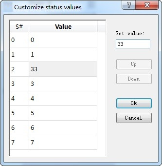
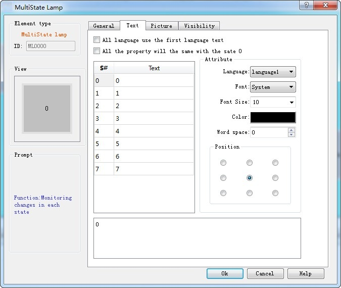
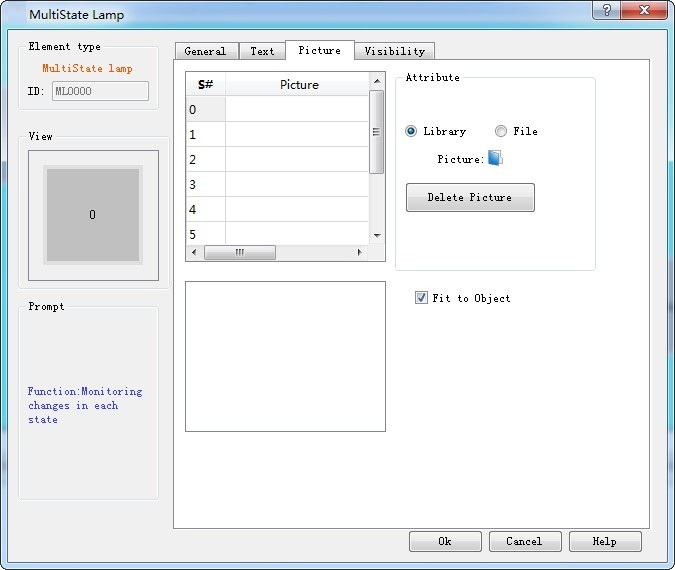

# Multi-state Indicator Lamp

The Multi-state indicator lamp control is mainly used to display different states according to the value of the monitor address. Up to 32 states can be displayed.

Click the Multi-state indicator button on the toolbar to bring up the dialog box as shown in Figure 4-83.

Figure 4-83    Multi-state Indicator Lamp dialog box

1\. General:

• State: User can change the status value in order to modify the border color, foreground color, background color and pattern of the control in different states

• State Type: (Assuming the user input value is n)

• Value: the written value is from zero to the number of total states minus 1.

• Register Bit: The written value is the n power of 2.

E.g.:

The monitor (read) address is LW3, then the total state number is 8. After, click OK to add the control to the screen; then add a numerical input control on the screen; set the write address and monitor address to LW3; finally save the project.

In the simulation or on the screen, user clicks on the numeric input control, and input a preferred state value through the input keyboard. If the input value is 2, the value of the monitoring (reading) address is 1, the control shows the text in the state of 1 (the text content in state 1 of the control in the Text page); correspondingly, when the value entered for the LW3 address is 8, the control will display the text content of state 3. If a value of 3 is input to the LW3 address, the multi-state indicator does not switch to any state.

• Customize status value: When user selects this option, a "Defined status value" button appears. Click it to bring up "Customize status value" dialog interface, as shown in Figure 4-84:

Figure 4-84    User-defined state value dialog box

In this dialog box, the "S \#" column is the current status column, that is, the selected value in it indicates the current status value; double- click a Value to enter the value in the current state that you want to write.

For example: The monitor (read) address is LW3, then the total state number is 8. After, click OK to add the control to the screen; then add a numerical input control on the screen; set the write address and monitor address to LW3; finally save the project.

In the simulation or on the screen, user clicks on the numeric input control, and input a preferred state value through the input keyboard. If the input value is 1, the value of the monitoring (reading) address is 1, the control shows the text in the state of 1 (the text content in state 1 of the control in the Text page); correspondingly, when the value entered for the LW3 address is 33, the control will display the text content of state 2. If a value of 2 is input to the LW3 address, the multi-state indicator does not switch to any state.

• Data Type: The data type of the write address and monitor (read) address

• Monitor address: The read address, which is a status value to be read, and then reflects the current state selected by user in the control.

• Total states: Users can set the total number of states according to individual need, which can be up to 32 states, that is from state 0 to state 31.

For example, selecting a data type of 16-bit positive integer, a total number of states of 32, when the data value stored in the monitor address is 0, the Multi-state indicator shows the text and the corresponding picture of the state 0; if the data value is 5, the Multi-state indicator will show the text and the corresponding picture of the state 5;. When the value is 60, the Multi-state indicator will still display the message of the State 31, because the total number of states up to 32 states.

Note: Shape, Border color, Foreground color, Background color and Pattern can be used with reference to that of "Bit Button" control.

Note: When "Multi-state indicator lamp” selects the 32-bit data type, the stored address occupies 2 words. For example, when write data to the SIEMENS PLC's data register, and the address written is V10 , then the occupied data register address includes V10 and V11; if users also use other controls to monitor the value of V11, an error will appear. Users should pay attention to the use of 32-bit data types in case ofNote data and address errors.

Note : The data category must be consistent with the data to be indicated.

2\. Text:

Click the "Text" tab of the Multi-State Indicator Property box to display the text property settings screen as shown in Figure 4-85 below:

Figure 4-85 Multi-state indicator text page

All languages use the first language text: This option is employed when dealing with multiple languages, that is, in the "Language" in the Project Manager, the total number of languages selected is greater than 1; in this case, the control text does not change with the switch of language.

• Language: This option is used when dealing with multiple languages. Select a different language, you can enter different text contents in different states, in order to achieve the multi-language. (In the function button, select the 'Switch language' option, and the language to switch to; in the simulation or screen, click this button, and then all the screen with text control will switch to that with text content of the specified language). For different languages, text content, font and font size can be different, but the color, kerning and position are the same.

• Font: You can choose the type of text for the input text; different states can choose different fonts, and different languages can choose different fonts.

• Font Size: You can choose the font size for the input text content; different states can choose different font sizes; different languages can also choose different font sizes.

• Color, Kerning, Position: Set the color, kerning, and alignment of the selected text. When you choose a language other than Language 1 in the Text page when the total number of languages selected in the Project Manager is greater than 1, the three functions: color, kerning and position are invalid because they are the same as the language 1.

3\. Picture:

Click the Picture tab of the Multi-State Indicator Property box to display the attribute settings as shown in Figure 4-86.

Figure 4-86 Multi-state indicator lamp picture page

This page is mainly employed to load pictures for different states. Picture of each state is empty by default while it can be changed according to personal need.

• Steps are as follows: Select the item in the list box whose picture needs to be changed, then choose the right picture either in system library or through save path on Windows. So when click on different status, corresponding pictures will be loaded below. In addition, user can also decide whether to fit to Object: if not, the margin and position of the control can also be modified, so as to beautify it.

• Fit to Object: When this is selected, the size of the graphic is the same as that of the controls on the General page while the Margin and Position options are hidden, otherwise they appear.

If import a picture from an external file, the "Transparent" option will display for use. This function is meant to make a specified color transparent

Note: Refer to "Bit button" control for Visibility page.

After setting all the properties, click "OK" and then add the control in the screen area
