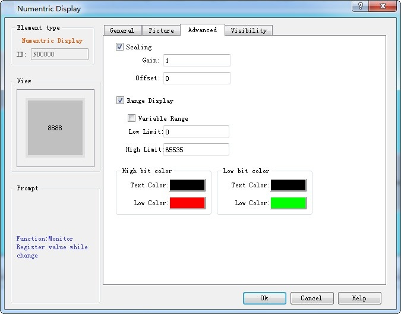
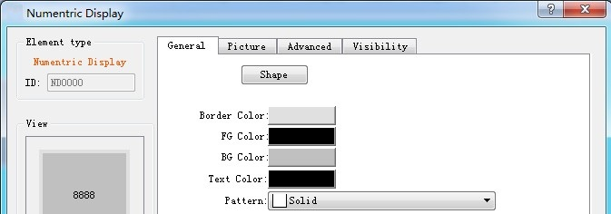
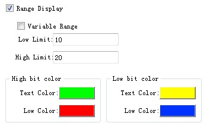
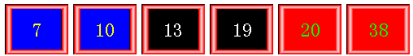

# Numerical Display

Numeric display control is a commonly used control displaying values in data register stored in PLC or other connected devices, such as speed, current, pressure and so on.

Select the display icon in the toolbar, and then the system will bring up a dialog box. As shown in Figure 4-91:

Figure 4-91 Numeric Display dialog box

In this dialog box, you can set the value saved in data register of PLC or other connected devices, such as the display digits, the decimal place, and font size, color, alignment and adjustment of text control.

• Data type: Users can choose different data categories according to the value of the register address to be monitored.

• Display Type: Users can choose different display categories according to project needs.

• Monitor address: Read address. The control is applied to display the data; the monitor address is the data register address carrying data to be displayed in PLC or other connected devices.

• Decimal Place: Display the number of decimal places for the data.

• Font: Choose a general font or digital font.

• Font size: Choose the size of the displayed font as needed.

• Alignment: The default is Center.

• Left: The numerical value displayed is in the left part of the display area.

• Center: The numerical value displayed is at the center of the display area.

• Right: The numerical value displayed is in the right part of the display area.

• Justification: The default is zero-suppression.

• Zero-suppression: Zero in front of the significant figure is hidden. If the value of the monitor address is 00123, a 16-bit positive integer, then the value displayed in the display box is 123.

• Zero Header: Display the leading zero of the effective number of bits. If the value of the monitor address is 00123, a 16-bit positive integer, then the value displayed in the display box is 00123.

• Space Header: Display the space instead of 0 in front of the significant digit. If the value of the monitor address is 00123, a 16-bit positive integer, then the value displayed in the display box is   123.

• Text Color: The font color of the data displayed;

Note: Shape, border color, foreground color, background color and style can be used with reference to "Bit button" control.

Note: Double-click the data display box to reset the contents and properties of the data display. When the control functions in the HMI, an on-screen keyboard will pop up, giving an access to the data input for user.

Note: The number of decimal place affects the data display. When the selected data type is 16/32-bit positive integer, 16/32-bit integer, and then the displayed value is acquired by offsetting the decimal point of return value by the set number of digits. If the value 212 is returned and the number of decimal places is 2, then 2.12 is displayed. If the selected data type is a 32-bit floating-point number, the value has no offset; but only the fractional decimal places are displayed. If the value 2.123 is returned and the scale is set to 2, only 2.12 is displayed.

Note: Total number of bits means the sum of the length of the integer part and the fraction part. If the integer length of the displayed value is greater than that of the integer part, the length of the displayed integer will be that of the actual value. For example, for the value 2123, the length of value is 2, and number of decimal place is 1, then it will display 212.3.

The Advanced page of Numeric display contains powerful functions, including Scaling and Range Display, as shown in Figure 4-92:

Figure 4-92    Numeric Display Advanced page

• Scaling: When this option is selected, the data displayed by the numeric display control is: Monitor (Read) Address Value × Gain + Offset

• Display Range: When this option is selected, user can set the lower and higher limit values as well as the low and high-level background color according to the needs. The address value monitored (read) by the control will be represented by different color patterns in the user-set lower and higher limit values.

• Variable range: the values of "Lower Limit" and "Higher Limit" are dynamically changed, depending on the address entered by the user

• Lower limit: Set the lower limit of the display. When the number displayed is lower than this limit, the background color will be the color set in Low Level Background Color.

• Higher limit: Set the higher limit of the display. When the number displayed is higher than this limit, the background color will be the color set in High Level Background Color.

For example, when you set the background color and text color in the General page and select the Range display color as shown in Figure 4-93:

Figure 4-93 Range Display Property Settings

When the value of the monitored address changes, the text and background of the numeric display change accordingly, as shown in Figure 4-94:

Figure 4-94    An example of numeric display

Note: Refer to the use of "Bit button" control for the Visibility page.

Note: When the 32-bit data type is selected, the stored address occupies 2 words. For example, when write data to the SIEMENS PLC's data register, and the address written is V10 , then the occupied data register address includes V10 and V11; if users also use other controls to monitor the value of V11, an error will appear. Users should pay attention to the use of 32-bit data types in case of Note data and address errors.

After the setting, click "OK" to add the control to the view area (that is, the screen)
