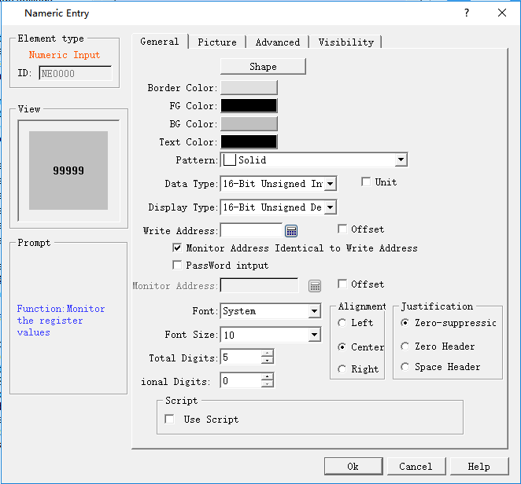
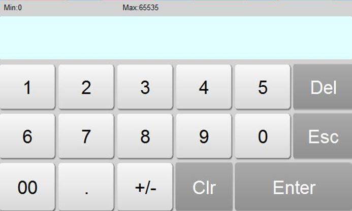
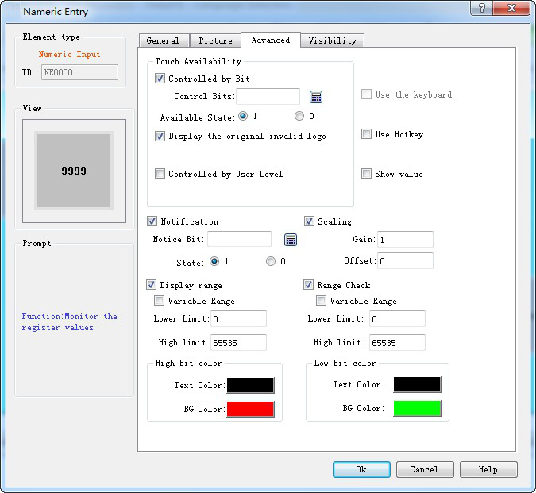
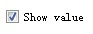
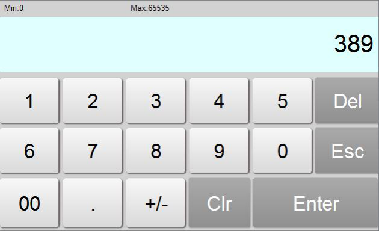
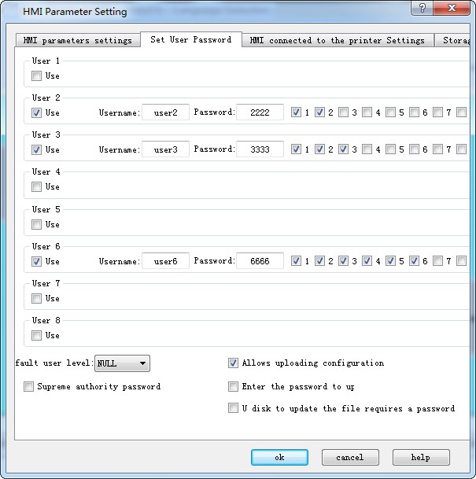
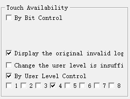
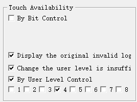
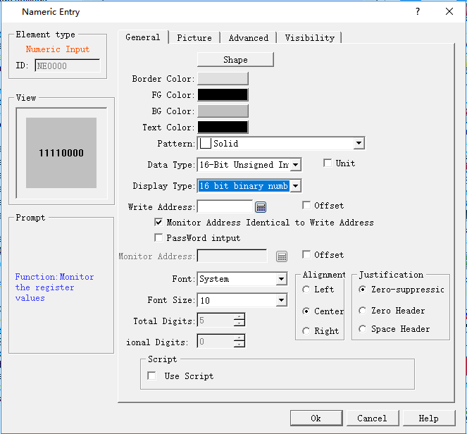

# Numerical Input

Numeric input is the most commonly used control, almost essential for all of the process control processes. It can input, display and store the value in the data register of the PLC or other connected devices, such as speed, current, pressure and so on.

Functions of Numeric input and numerical display are basically the same, and the only difference is that the numerical input can enter values to the data register of PLC or other connected devices, but not just display the value.

Specific operations to create a numeric input touch key are as follows:

Select the Numerical input iconin the toolbar, and a dialog box appears. As shown in Figure 4-95.

Figure 4-95 Numeric Input dialog box

Note: Shape, border color, foreground color, background color and pattern can be set with reference to "Bit button" control.

Note: Refer to the "Numerical Display" control for "Alignment", "Justification”, "Decimal Place" and "Total Digits".

Note: Double-click the data display box to reset the contents and properties of the data display. When the control functions in the HMI, an on-screen keyboard will pop up, giving an access to the data input for user, as shown in Figure 4-96.

Figure 4-96 Number input keyboard

Note: When the 32-bit data type is selected, the stored address occupies 2 words. For example, when write data to the SIEMENS PLC's data register, and the address written is V10 , then the occupied data register address includes V10 and V11; if users also use other controls to monitor the value of V11, an error will appear. Users should pay attention to the use of 32-bit data types in case ofNote data and address errors.

Note: The number of decimal place affects the data display. When the selected data type is 16/32-bit positive integer, 16/32-bit integer, and then the displayed value is acquired by offsetting the decimal point of return value by the set number of digits. If the value 212 is returned and the number of decimal places is 2, then 2.12 is displayed. If the selected data type is a 32-bit floating-point number, the value has no offset; but only the fractional decimal places are displayed. If the value 2.123 is returned and the scale is set to 2, only 2.12 is displayed.

Note: Total number of bits means the sum of the length of the integer part and the fraction part. If the integer length of the displayed value is greater than that of the integer part, the length of the displayed integer will be that of the actual value. For example, for the value 2123, the length of value is 2, and number of decimal place is 1, then it will display 212.3.

• Password input: "Password input" means the password input function, and the characters entered by the user are displayed in the form of "\*" in the process of inputting and displaying.

• Use Macro: Select the option of "Use Macro" to display the list of macros. User can select a macro to execute when the numeric input button is pressed. Only compiled macros are displayed in the drop-down list.

• Total digit: The total number, the sum of the integer part and the sum of the decimal parts. Controls the size of display and input values. The total number of decimal places is 4, and the decimal number is 1. The maximum decimal value is 999.9, which is the maximum value of the input and display of the control. The input exceeds the value, indicating errors; the display exceeds this value, ignores the redundant bits, and displays the number of settings only. Such as: total number of 4, decimal 1, the actual value of 12345, the control display effect of 234.5.

“Advanced” page: This page is mainly used to set the gain, offset and range check of input data (to check whether the input value is beyond the set range); In addition, the advanced page also has "Touch availability " and "Notification" options, which have the same functionality as that of the "Bit Button" control which users can refer to.

Click the "Advanced" tab, as shown in Figure 4-97:

Figure 4-97 Numeric Input Advanced page

• Controlled by Bit: If select this option, the control is not available until under specific conditions. When the "Valid Status" selected is 1, the "Bit Button" can be effectively touched if and only if the value of the "Control Bit" is 1. When the selected "Valid Status" is 0, the "Bit Button" can only be effective if and only if the value of the "Control Bit" is set to 0. Otherwise, the "Bit Button" cannot function no matter how.

• Controlled by User Level: User can select multiple options as needed. After setting, in the simulation or on the HMI screen, the current user is checked whether this user lever has the Visibility.

• Use Hot Keys: Refer to the Bit button.

• Show value: If select this option, the user data input, it will display the control value in the input keyboard when user inputs values, for example, the display value is 389, click on the Numerical input control, then the input area will show 389, otherwise the input area is empty, as shown below:

For example, if option 2 and 3 are chosen in the Effective Level Controlled in the Advanced Page of the control, and the User Password Setting in the Touch Screen Parameter Setting is as shown in Figure 4-98：

Figure 4-98 User Password Setting in the touch screen parameter setting

If Default User Level is NULL, this control is not touchable, and in this case you can use Change User Level in Function buttons to change the default level. For example, if the password entered by the user is 6666, corresponding to User Level 6, but the user chooses only option 1, not matching option 2 or 3, so the system will prompt that the password is incorrect; When the password entered by the user is 2222 or 3333, as both users have option 2, matching option 2 or 3, the password is valid and this control will be changed to a touchable control. If the Default User Level is user 2 to 3, then both user levels have option 2 to match the touching conditions, and then this control is touchable in simulation or initialized screen; If the Default User Level is user 3, then this user level does not have an option to match the touching conditions, and then this control is not touchable in simulation or initialized screen. The default setting is as shown in figure below:

If select “change the user level is insufficient”, when the user level is not matched, a login interface will pop up so that user can select a matching level and log in again, as shown below:

• Notification: In the case that the control can be touched, in the simulation or screen, click on the control to input a value through a pop-up input keyboard; then it will write the set state value (1 or 0) to the "Notice bit" address.

• Scaling: When this option is selected, the value written to the address = (the value entered by user through the pop-up keyboard - offset) / Gain; the displayed value (ie, the value of the monitor address) = the value of the monitor address × gain + offset

• Display Range: When this option is selected, user can set the lower and higher limit values as well as the low and high-level background color according to the needs. The address value monitored (read) by the control will be represented by different color patterns in the user-set lower and higher limit values.

• Variable range: the values of "Lower Limit" and "Higher Limit" are dynamically changed, depending on the address entered by the user

• Lower limit: Set the lower limit of the display. When the number displayed is lower than this limit, the background color will be the color set in Low Level Background Color.

• Higher limit: Set the higher limit of the display. When the number displayed is higher than this limit, the background color will be the color set in High Level Background Color.

• Range check: Check whether the input value is beyond the set maximum or minimum value.

After the settings, click "OK" to add the control to the view area (that is, the screen)

• When General page is set as shown below, the number is displayed in binary while we input number in decimal. When Display Type is other type, the input type is the same as the Display Type.

• After setting of the properties, click OK button, and then the mouse shape will become a cross. Now you can draw a rectangle in the screen by clicking the mouse and thus add this control into the screen.
