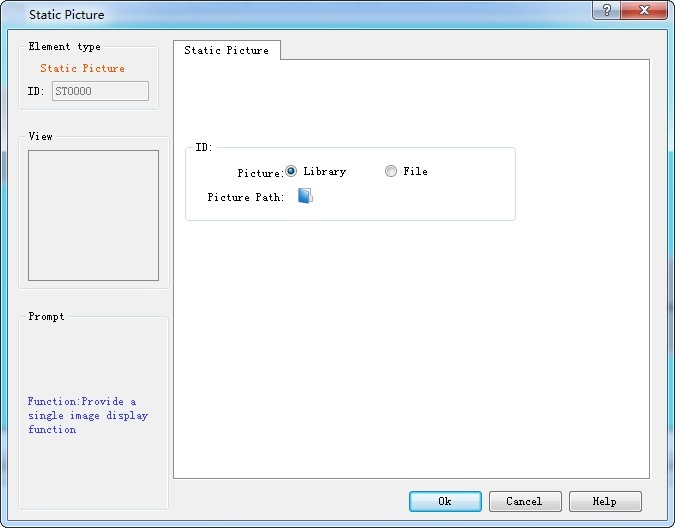

# Static Picture

The control of Static picture is mainly used to show a picture that can be in various formats from the file or from the library. With the picture loaded, it can be applied as a screen background to beautify the project interface.

1\. Click on the static picture icon on the toolbar to pop up a dialog box as shown in Figure 4-109:

Figure 4-109   Static picture dialog box

2\. After selecting a picture, click OK, and then the mouse cursor will become cross-shaped; left click on anywhere on the screen to add the picture control.

3\. The size of the inserted picture can be modified through the mouse. CommandHMI configuration software supports various image formats: JPG, BMP, PNG, WMF, EMF, GIF.
