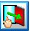
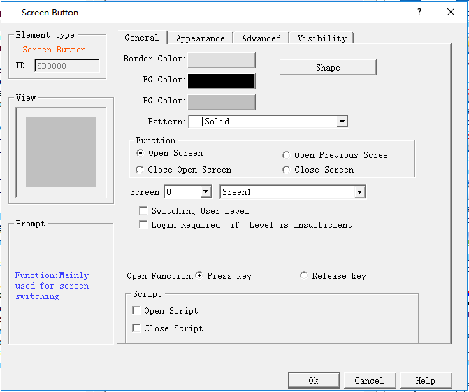
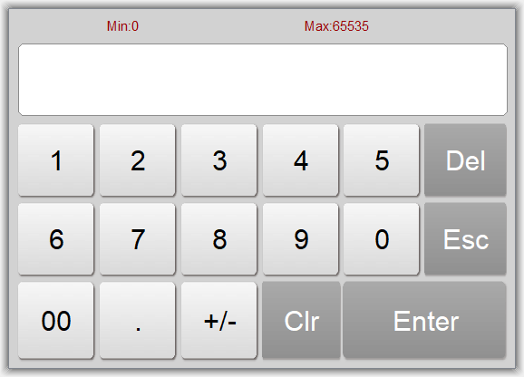

# Screen button

Screen button is designed for screen switching, changing the user level, pop-up window and other operations. After being set, it can make a screen/ window jump to a certain screen / window while you can also decide whether to change the user level at the same time.

• Click the icon button on the toolbar to bring up the dialog box , as shown in Figure 4-80.

Figure 4-80 Screen Button Dialog Box

Shape, border color, foreground color, background color and pattern settings can be used with reference to "Bit Button".

**Function modules:**

• Open Screen: It allows users to jump to the selected screen by clicking the button. This function can be employed on a screen or in a window.

• Open Previous Screen: It allows users to jump to the previous screen of this page by clicking the button. This function can only be used in the screen page.

• Close Open Screen: This function can only be used in the window page. It allows closing the current window and opening another window or screening.

• Close Screen: This function can only be used in the window page. This function allows closing the current window page.

**Switch user level:**

• Logout: Restore the current user level to the default user level

• Specified User Level: Change the current user level to the specified user level

**Open function:**

• Press: When the user presses the mouse, it executes the screen switching function.

• Release: When the user releases the mouse, it executes the screen switching function.

**Login required if level is insufficient:**

If the user has selected the " Controlled by User Level" option on the "Advanced" page of the "Screen Button" dialog box, and has changed the "Effective Lowest Level", then the screen control is only valid if the current user level is higher than or equal to the user- If the current user level is less than the effective minimum level set by the user, the password input box will pop up when the user touches the screen control on the touch screen, as shown in Figure 4-81:

Figure 4-81 Password input keyboard

This screen can only be opened when the password entered by the user is higher than that set by the user, and the current user level is decided by the level password just entered by the user.

**Macros:**

"Open macros" displays a list of macros. The user can select one to execute when press the button. Only compiled macros can be displayed in the drop-down list.

The "Label" page of the Screen Button is similar to that of the "Bit Button" control. Because the Screen Button has only one state, its Label page only has Status 1 Text and Status 1 Picture. Apart from that, the functions are the same.

The "Advanced" and "Visibility" pages of the "Screen Buttons" are the same as those of the "Bit Button" control, which can be used with reference to the Bit Button.

After setting all the properties, click "OK" and the mouse cursor will turn into a cross. Left click in the view area to add the control to the screen.
