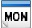
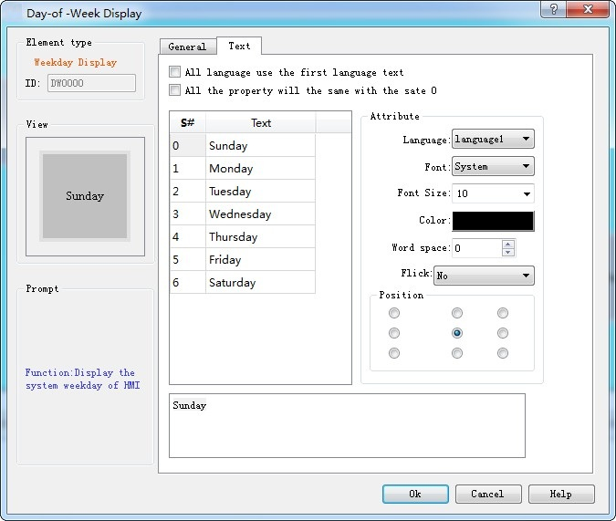

# Week Display

The control of Week Display is mainly used to display the system week. Click on the button icon  in the toolbar, then a dialog box will appear as shown in Figure 4-107:

Figure 4-107   Week Display dialog box

State: Change a different status value to set the border color, foreground color, background color and pattern of different states.

Note: Refer to Bit Button control for Shape, Border color, Foreground color, Background color and Pattern.

Click on the "Text" tab where you can modify the text display, such as the text content, text size, text color, kerning, line spacing, flicker and position. "Text" page interface is shown in Figure 4-108:

• Apply the first language text to all languages: When it comes to multiple languages (in the "Language" in the Project Manager, the total number of languages selected is greater than 1), and if this option is selected, the display contents do not change with the language switch.

• Language: This option is used when dealing with multiple languages. Select a different language, you can enter different text contents in different states, in order to achieve the multi-language. (In the function button, select the 'Switch language' option, and the language to switch to; in the simulation or screen, click this button, and then all the screen with text control will switch to that with text content of the specified language). For different languages, text content, font and font size can be different, but the color, kerning and position are the same.

• Font: Choose the font type for the input text; different states can have different fonts, and different languages can also have too.

• Font Size: Choose the font size for the input text content; different states can choose different font sizes, and different languages can also too.

• Color, Kerning, Position: Set the color, kerning, and alignment of the text in the current selection. When you select a language other than Language 1 and the total number of languages selected in the Project Manager is greater than 1, the applications of color, kerning and position are invalid because the values of the three function options are the same as those of the language 1

Note: To modify the contents of the text, first select the item to be modified in the list box, and then enter the text below the editting box.

After the settings, click "OK" to add the control to the view area (the screen)
