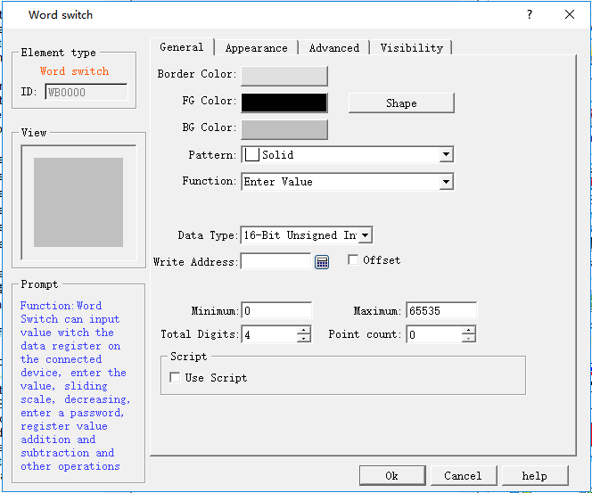
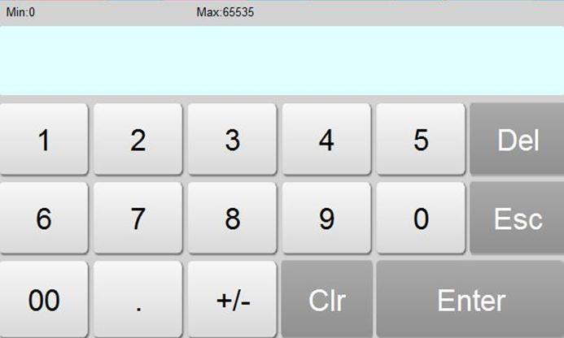

# Word Button

Word Button can support operations of Constant, Enter Value, Increasing, Decreasing, Enter Password, Add and Subtract to the data register address of connected device.

To add a word button:

• Select the Word Button iconon the toolbar, then he following dialog box is displayed, as shown in Figure 4-76:

Figure 4-76 Word Button dialog box

The shape, border color, foreground color, background color and pattern can be set with reference to "Bit Button" control.

**Function:**

• Set constant: You can choose different data types, CommandHMI software provides a variety of data types: 16/32-bit positive integer, 16/32-bit integer, 16/32-bit BCD positive integer and 32-bit floating point number. Setting a constant is to write the constant value you set to the write address. For example, if the write address is LW1 and the constant is set to 10, the value of LW1 is set to 10 every time the button is touched, regardless of its current value.

• Enter value: You can select a different data type; input a value between the maximum and minimum with a keyboard poping up after the word button being touched. As shown in Figure 4-77:

Figure 4-77

• Increasing: When the Delay parameter is 0, its function is the same as that of the Add. If the Delay parameter is not 0, the value of the write address increases by a constant value and is written to the register.

• Decreasing: When "Delay parameter" is 0, this function is the same as that of “Subtract". If "Delay parameter" is not 0, after a certain time, the value written to the address decreases by the constant value and is written to the register.

• Enter Password: Same as the "Enter Value" except that the "Enter Password" function has no option of decimal digits.

• Add: After choosing the data type, writing the address, constant and maximum value, every time you touch the "word button" control, the set value corresponding to the register value will plus the constant value based on the original value. Each time the button is touched, the value written to the address is incremented by a constant; however the value written to the address cannot exceed the maximum value you set. For example, the write address is LW1, the constant is 5, and the maximum value is 65535. Each time you click the Word Button control, the value of LW1 is added to the original value by 5, but the maximum value of LW1 cannot exceed 65535.

• Subtract: After choosing the data type, writing the address, constant and minimum value, every time you touch the "word button" control, the set value corresponding to the register value will minus the constant value based on the original value. Each time the button is touched, the value written to the address is decremented by a constant; however the value written to the address cannot be less than the maximum value you set. For example, the write address is LW1, the constant is 5, and the minimum value is 0. Each time you click the Word Button control, the value of LW1 is subtracted from the original value by 5, but the value of LW1 cannot be less than 0.

• Total number of digits: Number of data including that of decimal points.

• Decimal digits: When the data type is not "32-bit floating point" and there are decimal digits, then the maximum value of the input value should be reduced to 10 nth power. For example: When the selected data type is "32-bit positive integer", and the number of digits is 3, so the user can only enter the value of 0-99999.999.

• Macro: When "Use Macro" is chosen, the macro list is displayed. The user can select a macro to execute when the word button is pressed. Only compiled macros are displayed in the drop-down list.

The "Mark" tab of the "Word Button" is similar to that of the "Bit Button" control. Except that the Word button has no Status Text 1 neither Status Picture 1 because the Word Button has only one state.

If select the 32-bit data type for Word button, the address will occupy the length of two words. For example, write V10 to SIEMENS (Siemens) PLC data register, then the occupied data register address includes V10 and V11. If user still employs other control to monitor V11 value, it will fail to work. Pay attention to the application of 32-bit data type in case of error.

The Advanced and Visibility pages of the Word Button are the same as that of the Bit Button control. You can refer to the Bit Button control and refer to Bit Switch for the use of hotkey.
