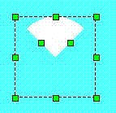

# Sector

Select the Sector command in the Draw menu or left-click the Sector command button in the toolbar; move the mouse to the screen editing window, and then it will become a cross, which means you can draw a pie chart in the screen now. As shown in Figure 4-35:

Figure 4-35   Sector Operation

Move the mouse to any point of the green dots in the middle of the rectangle, then the mouse will change to the shape ; change the arc of the sector by moving th emouse.
