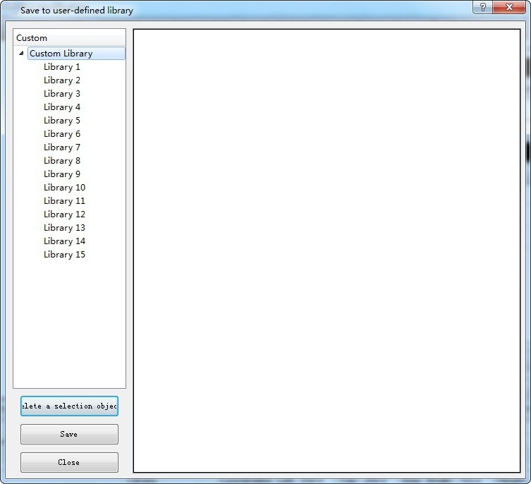

# Save to Library

Select the Save to Library command in the Draw menu or click the Save to Library command button in the toolbar to bring up the Library List dialog box, as shown in Figure 4-46:

Figure 4-46       Save to Library dialog

• CommandHMI configuration editing software can save the completed configuration screen for engineering designers in order facilitate the next operation. After clicking Save to Library, as shown in the figure above, the graph object in the current screen will be displayed in the white area in the middle of the dialog.

• There are three options in the function selection:

Select the area as a library: Choose the selected object in the screen as a library object

Import Library: Import a library file suffixed HM from external (the file is generally provided by CommandHMI).

Import a picture from a file: Import a picture from an external file as a library object.

• Click the "Save to..." button and select "Library II", as shown in Figure 4-47:

Figure 4-47     Save path selection dialog

Choose a save path in the selection box on the left. CommandHMI configuration editing software provides 8 custom control library and 8 custom graphics library eight, select the saved path, then click the bottom of the "Save" to save the graphics Object, the saved graphic object is displayed in the white area on the right. Then click the OK button to complete the operation. If you want to view the newly saved graphics, click the Open Lib command button , in the pop-up dialog box, pull the scroll bar to the bottom of the left list, then select the "Custom Gallery" in the "Gallery II" Save the modified graphics.
