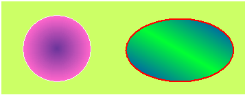

# Circle/Ellipse

Select the Circle/Ellipse command in the Draw menu or left-click the Circle/Ellipse command button in the toolbar. Move the mouse to the screen editing window, and the mouse cursor will become a cross; click the left mouse button on the screen to add a circle to the screen.

:Change the height of the ellipse / circle

 :Change the width and height of the ellipse / circle

After the above steps, the transparency, line type, line width, line color, and fill pattern of the ellipse / circle will be set by default. The engineer can modify these attributes to meet the needs of the project. Move the cursor to the ellipse / circle, double click the left button; or select the Circle/Ellipse first, and then click the Property button in the toolbar, here a dialog box will pop up.

The CommandHMI configuration software provides up to 15 types of border line, 10 kinds of border line width and 21 of fill patterns for ellipse / circle. As shown in Figure 4-32:

Figure4-32    Circle/Ellipse
