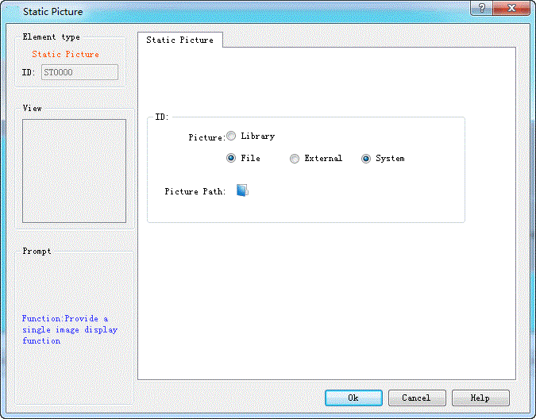
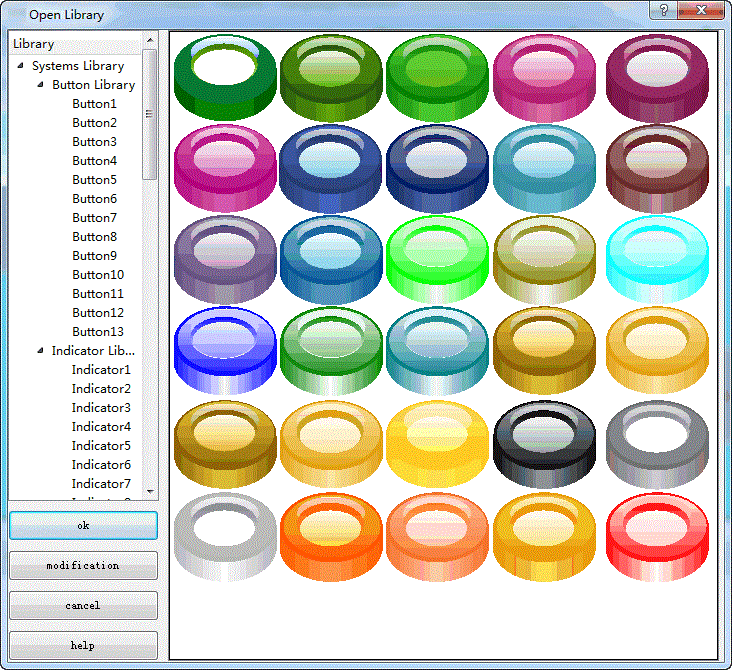
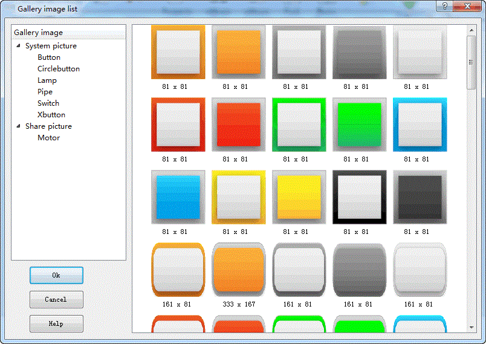
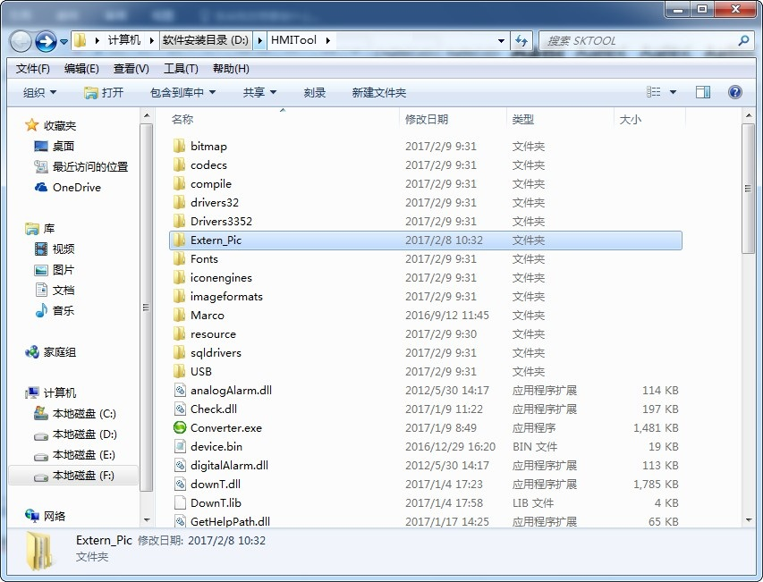
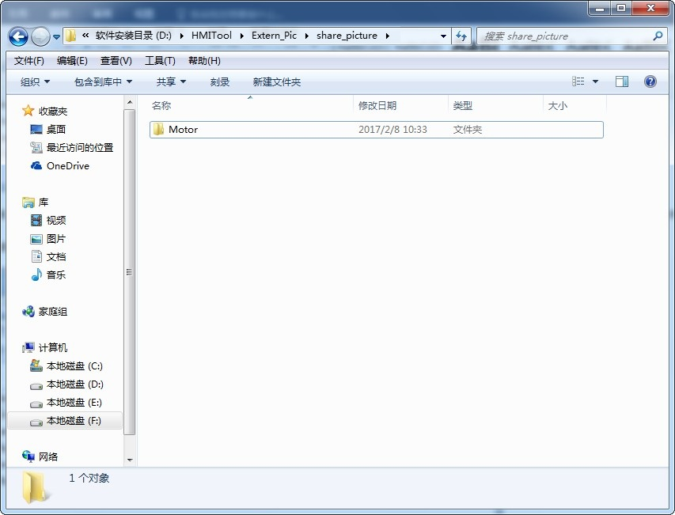

# Extern Picture

In CommandHMI, pictures can be inserted into a number of controls; take the Static Picture as an example:

Picture:

Library: Built-in gallery in the system, as shown below:

File: Consist of External File and System File. External pictures can be those in computer and system pictures are available for downloading on the official website, which will be saved in the folder of Extern_Pic under the installation directory.

When "System" is selected, the following dialog box will pop up:

These images are stored in the Extern_Pic folder under the installation directory, as shown below:

The Extern_Pic folder contains two folders: the share_picture folder and system_picture folder, corresponding respectively to the shared picture and system picture in the [Gallery image list](#图库图片列表), of which those in the system_picture folder are system pictures that cannot be added or modified. While those in the share_picture folder can, as shown in the following figure:

You can add other folders by yourself in the share_picture folder or change the name of an existing folder (for example, Motor), meanwhile the name of share_picture folder cannot be changed. In addition, it is possible to add or delete pictures of the Motor folder.

The compressed file of share_picture.rar is available for downloading on the official website; unzip it into PC after downloading; follow the above method to add it into the share_picture folder, and then it is also available in the [Gallery image list](#图库图片列表).
