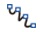

# Free Line

Select the Free Line command in the Draw menu or click the Free Line command button in the toolbar. Move the mouse to the Edit window and the cursor     will change to a cross shape so now you can draw a free line in the Edit window.

Move the mouse to a position where you want to free line; click the left mouse button, and a small green dot will appear in the editing window, which is the starting position of the free line.

Move the mouse to other positions in the screen, and then the system will automatically draw a free line following the trajectory of the mouse movement; click the left mouse button or right button to complete drawing the free line. As shown in Figure 4-28:

Figure4-28         Free Line Operation

In this case, you can adjust the properties of the free curve through the pull-down and fine-tune buttons. The CommandHMI configuration software provides up to 6 straight line types, 30 kinds of line width and 6 types of straight-line end arrows for curves / arcs.
