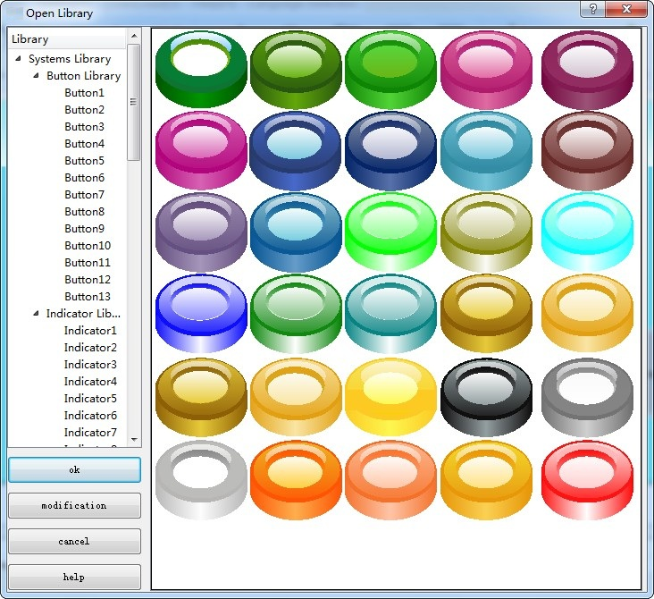
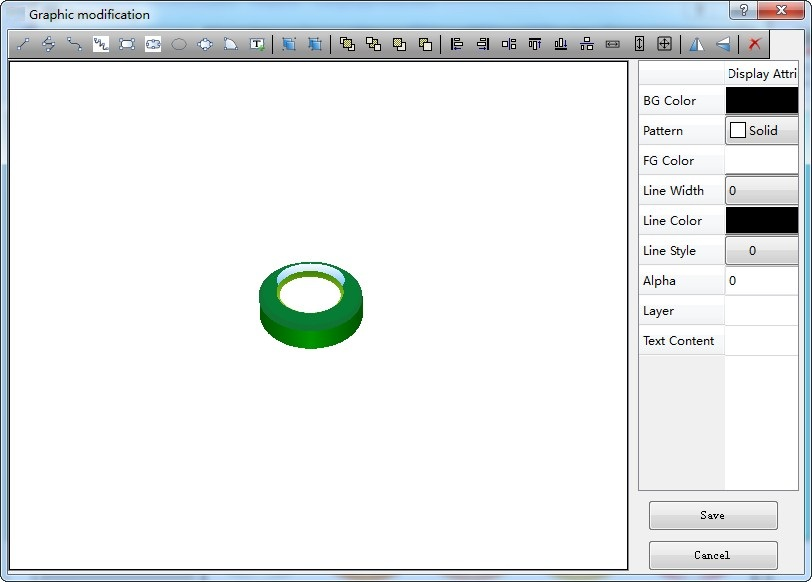
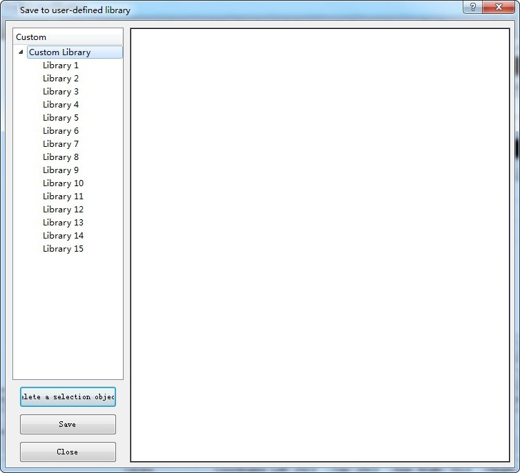

# Open Library

Select the Open Library command in the Draw menu or click the Open Library command button in the toolbar to bring up the Library List dialog box, as shown in Figure 4-43:

Figure 4-43     Library List

The system library of CommandHMI configuration editing software provides a wealth of graphic objects for engineering designers. CommandHMI version is even added a large number of buttons, indicators and other graphic objects. Engineering designers can find a proper graphic object so as to save configuration design time.

Engineers only need to click on the category of the desired graphic object in the system library on the left. Click the + sign to open the sub-category, and then select the desired graphic. Click to select the image, and then click on the screen to add graphic object when the cursor become a cross.

Modify: After selecting the graphic you want to modify, click the "Modify" button at the bottom left of the dialog box, as shown in Figure 4-44:

Figure 4-44 Library Modify Dialog Box

In the interface shown as Figure 4-44, select the graphic, and then execute the "Split" function on the tool bar to split the control. Then you can choose one part to modify: settings of foreground color, background color, pattern and others can be found on the right of the dialog box. After modification, execute the Group command to the entire split graphics, and then click the "Save".

Figure 4-45     dialog box is displayed

In the "Custom" list on the left of the dialog box, select the location where you want to save the modified graphics (e.g. "Library 2") and click "Save". If you want to view the newly saved graphics, click the Open Lib command button in the pop-up dialog box, then select the "Custom Library".
