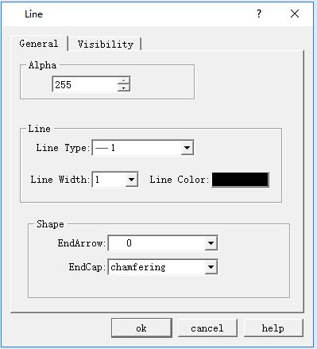

# Line

Select the “Line” command in Draw menu or left-click the line button  in the toolbar; move the mouse in the screen editing window, and it will become a cross; click on the mouse in the view (i.e. screen), then a line is added.

After the above steps, the transparency of the line, the line type, width, color, the arrow and shape of end will be set by default while engineers can modify these properties in order to meet the needs of projects. Double click over a straight line, or click on the Property button in the toolbar after selecting it. Line Property dialog box will pop up, as shown in Figure 4-24:

Figure 4-24 Line Property dialog box

CommandHMI configuration software provides up to 6 straight line types, 30 kinds of line width, and 6 straight-line end arrows, with the ability to adjust the properties using the pull-down and trimming buttons. To change the length, direction, and position of the line, select the line first, then move the mouse to the end of the line; after that hold the left button of the mouse, and drag the mouse to the right position to release the left button.
