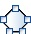
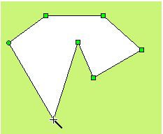
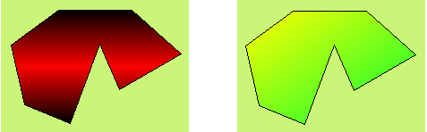

# Polygon

Select the Polygon command in the Draw menu or click the Polygon command button in the toolbar. Move the mouse to the editting window. The mouse will change to a cross, by now you can draw a polygon in the screen.

Move the mouse to a position where you want to draw a polygon, left click (or hold down the left button), then a small green dot will appear in the screen editing window, which is the start point of the polygon.

Move the mouse to another position on the screen. At this time, the system will draw a straight line automatically. Move the mouse to other appropriate positions; each time you left click, a new side of polygon is drawed; right click to complete drawing. As shown in Figure 4-33:

Figure 4-33   Polygon Operation

To re-shape a polygon, click it first and it will appear several green dots (depending on the number of sides of the polygon), indicating that the polygon has been selected; and then move the mouse cursor over one of them, then it will become the shape ; left click and drag it to the position you prefer, so that you can change the length and location of two lines connected by this turning point. Release the left button to complete.

You can adjust the properties of polygon through the pull-down and fine-tuning buttons. CommandHMI configuration software provides up to 15 types of border line, 10 kinds of border line width and 21 kinds of fill patterns for the polygon.As shown in Figure 4-34:

Figure 4-34   Polygon
