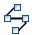
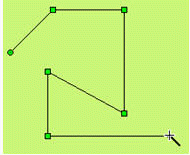

# Polyline

Select the Polyline command in the Draw menu or click the Polyline command button in the toolbar to move the mouse to the Edit window. The mouse will change to a cross. That’s when you can draw a polyline in the Edit window.

Move the mouse to a position where you want to draw the polyline. Click the left mouse button once, then a small green dot appears in the screen editing window, which is an endpoint of the polyline.

Move the mouse to other positions in the screen, the system will automatically draw a straight line; move the mouse to change the direction; left click once and the  place where you click will appear a small green box. Here the line from the first endpoint to the first small green rectangle will not move with the mouse. The mouse can be moved to the next point to change the direction of the polyline, just click the left mouse button. When you need to complete the drawing of the polyline. Lastly right click to complete drawing the polyline, as shown in Figure 4-25:

Figure 4-25        Polyline Operation

You can adjust the properties of the polyline using the pull-down and fine-tune buttons. The CommandHMI configuration software provides up to 6 straight line types, 30 kinds of line width, and 6 types of end arrow for polylines. To change the length, direction and position, select the line first, and then move the mouse to the polyline; hold down the left button of the mouse, after, drag the mouse to the appropriate location to release the left button.
