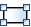
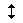
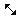
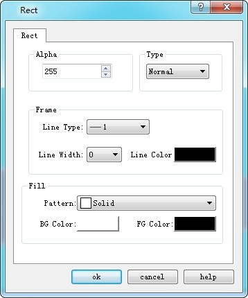
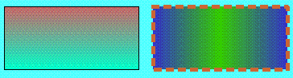

# Rectangle

Select the Rectangle command in the Draw menu or click the Rectangle command button in the toolbar button. Move the mouse to the Edit window and then the cursor will change to a cross; click on the screen to add a rectangle.

: Change the height of the rectangle

 : Change the width and height of the rectangle

After the above steps, the transparency, line type, line width, line color and fill pattern of the rectangle will be set by the system default. The engineer can modify these properties to meet the needs of the project. Move the mouse to the rectangle, double click the left button; or select the rectangle first, and then click the Property button in the toolbar. The properties of the rectangle will pop up, as shown in Figure 4-29:

Figure 4-29     Rectangle properties dialog

You can adjust the properties of the rectangle through the pull-down and fine-tune buttons. CommandHMI configuration software provides up to 15 types of borderline, 10 kinds of borderline width and 21 kinds of fill patterns. As shown in Figure 4-30:

Figure 4-30     An example of a rectangle drawn
