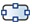
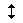
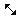
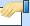
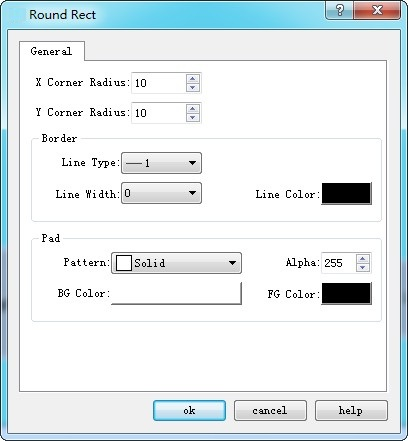

# Rounded Rectangle

Choose the icon from Basic Graphs in the control bar, move the cursor to editing area, and the cursor will become a cross.

Click the starting position where the graph will be placed, drag the cursor when pressing the mouse key.  At this moment the system will automatically draw an area along the track of the cursor. Then, click left or right mouse key to complete drawing of rectangle.

: Change the height of the rounded rectangle

 : Change the width and height of the rounded rectangle

After the above steps, the transparency, line type, line width, line color and fill pattern of the rounded rectangle will be set by the system default. The engineer can modify these properties to meet the needs of the project. Move the mouse on it, double click the left button; or select the rounded rectangle first, and then click the Property buttonin the toolbar. The properties of the rectangle will pop up, as shown in Figure 4-31

Figure 4-31     Rectangle properties dialog

Radius of X curve: Radian of the four corners in X direction.

Radius of Y curve: Radian of the four corners in Y direction.
