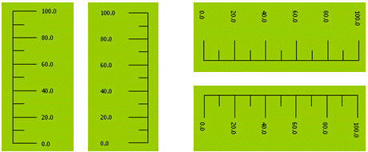
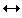

# Scale

Select the Table command in the Draw menu or the left click mouse the command button in the toolbar, then it will appear a pop-up scale dialog box, as shown in Figure 4-41:

Figure 4-41     Scale Dialog Box

In the above dialog box, CommandHMI configuration software provides choices of Color, Axis and Text. The color item allows to selecting the line color and text color. You can select whether to display the axes in the Axis item and decide the number of the major scale and sub scale by means of the trimming button or inputting directly. Decide whether to display text in the text item and change the maximum and minimum values of the scale, as well as the size of the text and the decimal digits of the scale value.

When you have modified the scale property and click OK to close the dialog box, move the mouse to the position where you want to display the scale. Click the left mouse button, and then the system will automatically draw a scale unit. As shown in Figure 4-42:

Figure 4-42     Scale effect diagram

After the above steps, a scale like first from left of the figure above. If you want to change it to the form of the second left scale in the figure above, first choose the scale, move the mouse to one of the height sides, press down the left key and drag the mouse when the mouse becomes, and have the mouse pass through the other height side. To change the scale to the right forms in the figure above, perform Free Rotation for it.
