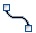
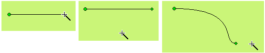
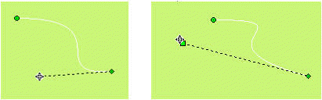

# Curve / Arc

Select the Curve / Arc command in the Draw menu or click the Curve / Arc command button in the toolbar menu; move the mouse to the Edit window, then the mouse cursor will change to a cross, by now you can draw a curve / arc in the Edit Window.

Move the mouse to a position where you want to curve. Left click and a small green dot appears in the window. This position is the start position of the curve / arc.

Move the mouse to other position in the screen, then the system will automatically draw a straight line; after click the left mouse button and release.

At this time, the mouse cursor is still cross-shaped. Move the mouse to other position in the screen, which is the end of the curve / arc. Hold down the left button does and move the mouse in the screen to draw the arc; release the mouse and right click to end the operation. As shown in Figure 4-26:

Figure4-26         Curve Operation

As shown above, the starting point of the graph is a green dot, and the end point is a diamond dot, here the initial curve / arc has been drawn. Move the mouse to the point and the cursor becomes the shape of ; hold down the left mouse button, move the mouse to the appropriate location, and then release the mouse to draw the required curve. You can also move the start or end point to the appropriate position. As shown in Figure 4-27:

Figure4-27         Curve Operation

You can adjust the curve / arc properties through the pull-down and trimming buttons. The CommandHMI configuration software provides up to 15 line types, 10 kinds of line widths, and 6 straight-line end arrows for curves / arcs.
