# Align

This command is by group, so is the Size. CommandHMI configuration software allows engineers to operate alignment and size operation on multiple graphical objects, but only when multiple graphic objects are selected. Users can hold down the key Ctrl to select the graphic objects to be aligned, or hold down the left mouse button and drag to delineate them. Alignment operations include a large number of editing commands: Left, Right, Vertical Center, Horizontal Center, Top, Bottom, Horizontal Equal Interval and Vertical Equal Interval, Make same width, Make same height, Make same height and width, etc.

• **Top**

The command of Top Alignment allows engineering designers to top justify multiple graphic objects (no less than two graphical objects) through clicking “Top” of the Alignment in the Edit menu or through the context menu. These graphic objects will take the highest edge of graphic objects as a reference, and then make them at the same level. Before and after comparison diagram of Top Alignment is shown in Figure 4-16:

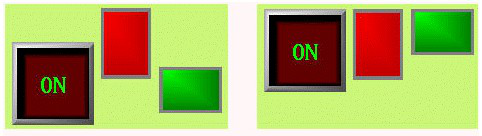

Figure 4-16 Before and after comparison diagram of Top Alignment

• **Bottom**

The command of Bottom Alignment allows engineering designers to bottom justify multiple graphic objects (no less than two graphical objects) through clicking “Bottom” of the Alignment in the Edit menu or through the context menu. These graphic objects will take the lowest edge of graphic objects as a reference, and then make them at the same level.

Before and after comparison diagram of Bottom Alignment is shown in Figure 4-17:

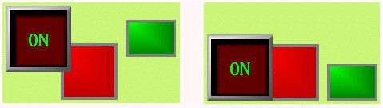

Figure 4-17 Before and after comparison diagram of Bottom Alignment

• 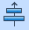**Vertical Center**

The command of Vertical center allows engineering designers to make centers of graphical objects in the same vertical line (no less than two graphical objects) through clicking “Vertical center” of the Alignment in the Edit menu or through the context menu. This vertical line is the vertical centerline of the leftmost and rightmost edges.

Before and after comparison diagram of Vertical Center Alignment is shown in Figure 4-18:

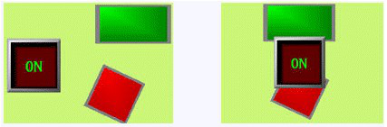

Figure 4-18 Before and after comparison diagram of Vertical Center Alignment

• **Left**

The command of Left Alignment allows engineering designers to left justify multiple graphic objects (no less than two graphical objects) through clicking “left” of the Alignment in the Edit menu or through the context menu. These graphic objects will take the leftmost edge of graphic objects as a reference, and then make the left sides of each graphic object along the same vertical line.

Before and after comparison diagram of Left Alignment is shown in Figure 4-19:

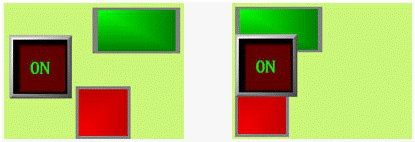

Figure 4-19 Before and after comparison diagram of Left Alignment

• **Right**

The command of Right Alignment allows engineering designers to right justify multiple graphic objects (no less than two graphical objects) through clicking “Right” of the Alignment in the Edit menu or through the context menu. These graphic objects will take the rightmost edge of graphic objects as a reference, and then make the right sides of each graphic object along the same vertical line.

Before and after comparison diagram of Right Alignment is shown in Figure 4-20:

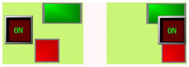

Figure 4-20 Before and after comparison diagram of Right Alignment

• **Make same width**

This command allows engineering designers to make multiple graphic objects (no less than two graphical objects) have the same width through clicking “Make same width” of the Size in the Edit menu or through the context menu. These graphical objects will be reduced or enlarged by the upper left point while the height remains unchanged, so that the width of each graphic object is in accordance with what has been selected before (surrounded by black points while others by green points).

Before and after comparison diagram of Make same width is shown in Figure 4-21:

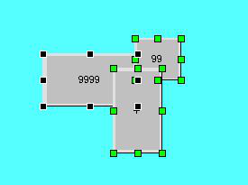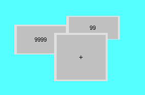

Figure 4-21 Before and after comparison diagram of Make same width

• **Make same height**

This command allows engineering designers to make multiple graphic objects (no less than two graphical objects) have the same height through clicking “Make same height” of the Size in the Edit menu or through the context menu. These graphical objects will be reduced or enlarged by the upper left point while the width remains unchanged, so that the height of each graphic object is in accordance with what has been selected before (surrounded by black points while others by green points).

Before and after comparison diagram of Make same height is shown in Figure 4-22:

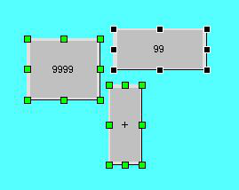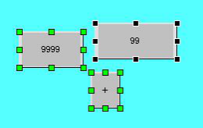

Figure 4-22 Before and after comparison diagram of Make same height

• **Make same height and width**

This command allows engineering designers to make multiple graphic objects (no less than two graphical objects) have the same height and width through clicking “Make same height and width” of the Size in the Edit menu or through the context menu. These graphical objects will be reduced or enlarged by the upper left point, so that the height and width of each graphic object is in accordance with what has been selected before (surrounded by black points while others by green points).

Before and after comparison diagram of Make same height and width is shown in Figure 4-23:

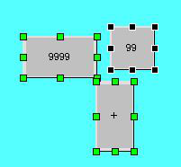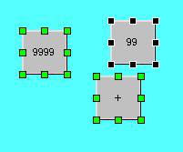

Figure 4-23 Before and after comparison diagram of Make same height and width

• **Horizontal Equal Interval**

This command allows engineering designers to make multiple graphic objects (no less than two graphical objects) have the equal interval horizontally through clicking “Horizontal Equal Interval” of the Alignment in the Edit menu or through the context menu.

• **Vertical Equal Interval**

This command allows engineering designers to make multiple graphic objects (no less than two graphical objects) have the equal interval vertically through clicking “Vertical Equal Interval” of the Alignment in the Edit menu or through the context menu.

Before executing commands of Make same width, same height, same width and height, please make sure whether the selected objects have been rotated. The height and width of rotated object also rotate with itself.
