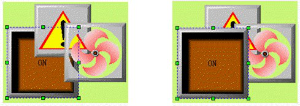
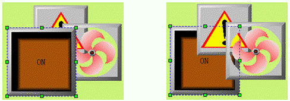
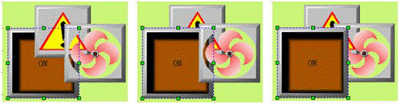
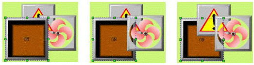

# Layer

Layer Command is by group. It is used to adjust the display level of intersecting graphic objects. Each object CommandHMI has a graphic level; the top of the graphic objects are always displayed on top of the lower graphic objects, so you can use this command to adjust the hierarchy level. The default level of new graphic object is higher than that of original. CommandHMI Layer consists a total of four commands: Bring To Top, Bring Forward, Send to Bottom and Send Backward. To execute this command, you need first select one or more graphical objects on the current screen, and then select the corresponding command in the Edit menu or toolbar menu.

• **Bring To Top**

Execute this command to move the selected graphic object to the uppermost layer of all graphic objects, so that the selected graphic object will overwrite the intersecting part.

First choose an object in several graphs, and then choose Bring To Top command in Edit menu, or command buttonin the toolbar buttons, or call the right click menu and choose Bring To Top command in the Layer option. See Figure 4-8 for a comparison before and after combination.

Figure 4-8 Contrast before and after Bring To Top

• **Send To Bottom**

Execute this command to send the selected graphic object to the lowermost layer of all graphic objects, so that the intersecting part of the selected object will be invisible.

First choose an object in several graphs, and then choose Send To Bottom command in Edit menu, or command buttonin the toolbar buttons, or call the right click menu and choose Send To Bottom command in the Layer option. See Figure 4-9 for a comparison before and after combination.

Figure 4-9 Contrast before and after Send To Bottom

• **Bring Forward**

Execute this command to bring the selected graphic object one level forward to the intersecting graphic objects. You first need to select one object in multiple graphic objects, and then select "Bring forward" in the Edit menu or the toolbar button, or right click to bring up the context menu containing “Bring forward” in the series commands of Layer.

First choose an object in several graphs, and then choose Bring Forward command in Edit menu, or command buttonin the toolbar buttons, or call the right click menu and choose Bring Forward command in the Layer option. See Figure 4-10 for a comparison before and after combination.

Figure 4-10 Contrast before and after Bring Forward

• **Send Backward**

Execute this command to send the selected graphic object one level backward to the intersecting graphic objects. You first need to select one object in multiple graphic objects, and then select " Send backward" in the Edit menu or the toolbar button, or right click to bring up the context menu containing “Send backward” in the series commands of Layer.

First choose an object in several graphs, and then choose Send Backward command in Edit menu, or command buttonin the toolbar buttons, or call the right click menu and choose Send Backward command in the Layer option. See Figure 4-9 for a comparison before and after combination.

Figure 4-11 Contrast before and after Send Forward
