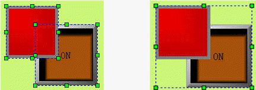
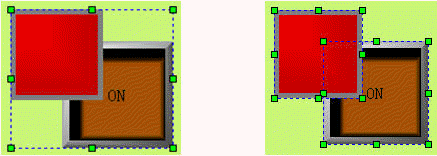

# Group and Ungroup

The combination command is a group command, which is to combine 2 or more graphics objects and controls in the current screen into a graphic object, a whole, and 2. The contents of the combination can be graphics drawn by engineering designers, or drawn by themselves, or can be system library graphics, or other controls, such as alarm controls, trends, and so on. After the combination control, keep the property of the original control object, which can be modified. The cancellation combination is to decompose the graph which is combined with the combination command into several original combination elements, and cancel the combination command is the reverse operation of the combination command.

**Methods of Grouping:**

First it needs to select multiple graphic objects, and then select the Group command in the Edit menu, or that command button in the toolbar menu, or right click to bring up the context menu and select "Group" item, before and after comparison picture is as Figure 4-6:

Figure 4-6     before and after group command

**Methods of ungrouping:**

Select a combined graphic object from grouping, and then select the Ungroup command in the Edit menu, or in the toolbar menu, or in the context menu; before and after comparison picture is as Figure 4-7:

Figure 4-7     before and after ungroup command

Select multiple objects through Ctrl key.
