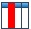

# Alarm Bar

         The Alarm Bar is used to display the current alarm. It differs from the alarm control in that the dynamic alarm bar displays the current alarm contents (digital alarm contents and analog alarm contents) in the form of text scroll.

If there are three alarms, then the dynamic alarm bar will scroll display the first alarm, then the second, and finally the third, and so on. The scroll direction is from right to left, but it is also possible to make it from left to right; the speed, movement interval time and alarm sound are determined by the properties; please refer to "Alarm display setting". Before using the dynamic alarm bar, you need to configure the alarm settings; refer to "Alarm settings" please.

Add the alarm bar:

Select the Alarm Bar or the button in the Tool menu, as shown in Figure 4-60:

Figure 4-60    Alarm Bar dialog

Select all alarm contents: When this option is selected, the alarm display control will display all the alarm information of "Digital Alarm" and "Analog Alarm" in the Project Manager; otherwise, only the specified alarm information selected by the user will be displayed.

• Language: For different languages, font size, font, time, date and message content can be different, and the background color and text color are the same as the first language.

• Font: Change the font format of the alarm contents

• Font Size: Change the font size of the alarm content

• Text color: Change the font color of the alarm contents

• Speed: Movement step of the alarm contents.

• Direction: The moving direction of the alarm content ( Left or Right)

• Alarm Sort: The order of the alarm display.

• Application of shape, border color, background color, foreground color and pattern can be used with reference to "Bit Button" control.

• When calling off-line simulation, the font size should be "16x16"; in other case, you can choose otherwise.

• The "Visibility" page can refer to that of "Bit Button" control.
