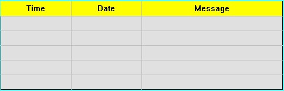

# Alarm Display

The alarm control can display the alarm information of the current equipment (digital alarm and analog alarm). Before executing this control, it needs to configure the alarm settings. For ways to configure the alarm settings please refer to "Alarm setting".

Alarm control can store real-time alarm information, and the number of alarms is determined when you configure. CommandHMI supports digital alarm messages.

Add the alarm control:

Select the Alarm Control in the Tool menu or select the Alarm Control button in the Toolbar menu; a dialog box shown in Figure 4-58 will pop up:

Figure 4-58    Alarm Display dialog

In the alarm display box, you can set the color and size of the display frame, color and type of the grid line, the time, date and color of alarm title. In the Text box, you can also set font size, text color and number of rows of alarm message. If the row is set to 5, then the alarm control can display 5 alarm messages, when there is a new alarm occurs, the earlier one will be replaced.

Language: For different languages, font size, font, time, date and message content can be different while the background color and text color are the same as the first language.

Select all alarm contents: When this option is selected, the alarm display control will display all the alarm information of "Digital Alarm" and "Analog Alarm" in the Project Manager; otherwise, only the specified alarm information selected by the user is displayed.

Set up and press OK, then left click to draw the alarm control on the screen, as shown in Figure 4-59:

Figure 4-59      Alarm Display control

• The size of the alarm control is determined by the rows and the maximum character size of the alarm. The mouse can resize it and the position of the alarm control can be adjusted.

• When the number of alarm content branches is bigger than that of rows, the alarm control will automatically add one row, as well as a scroll bar to display the alarm information.

• The "Visibility" page can refer to that of "Bit Button" control.
