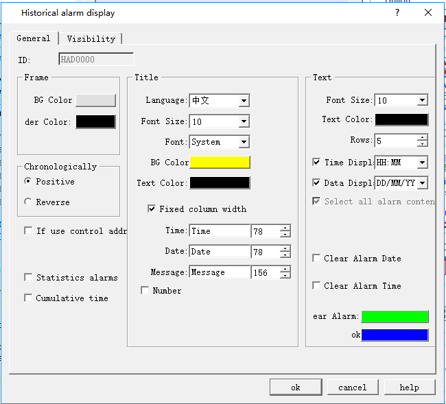

# Historical Alarm Display

The main function of Historical Alarm is to display the previous alarm contents; the operation is the same with that of Alarm display, which means you can refer to the application of the alarm display. Click the Historical Alarm button  on the toolbar to bring up the following dialog box:

Control address: Write 1 to the address register 0 in address offset (16-bit integer, same to 1 to 12); write the start time to address register 1~ 6 in address offset, and write the end time to that of address register 7 ~ 12. Then the historical alarm display will show the data content during the corresponding time. If you want to display all the historical alarm information, write 0 to the 0 address register. Address Register 13 in Address Offset is not useful for now.

This address occupies 12 consecutive address offset; the meaning of each is as follows:

|                |                                                                                              |
|----------------|----------------------------------------------------------------------------------------------|
| Address offset | Controlled object by control register address                                                |
| 0              | 1 represents display the data between the start and end time; 0 means all data is displayed. |
| 1              | Start time (Year)                                                                            |
| 2              | Start Time (Month)                                                                           |
| 3              | Start time (Day)                                                                             |
| 4              | 4Start Time (Hour)                                                                           |
| 5              | Start Time (Min)                                                                             |
| 6              | Start Time (Second)                                                                          |
| 7              | End time (Year)                                                                              |
| 8              | End Time (Month)                                                                             |
| 9              | End Time (Day)                                                                               |
| 10             | End Time (Hour)                                                                              |
| 11             | End time (Minute)                                                                            |
| 12             | End time (Second)                                                                            |

• Clear alarm date: Cancel the alarm date

• Clear alarm time: Clear the alarm time

• Clear alarm: The line used to remove the alarm is marked with this color

• Statistics alarms: Enable alarm count,which is showed  after the alarm message.

• Cumulative time: Enable alarm cumulative time,which is showed after the alarm message.

• OK: Indicate the alarm with this color when it is generated

The basic operation can refer to "Alarm Display" control.

The "Visibility" page can refer to that of "Bit Button" control.
