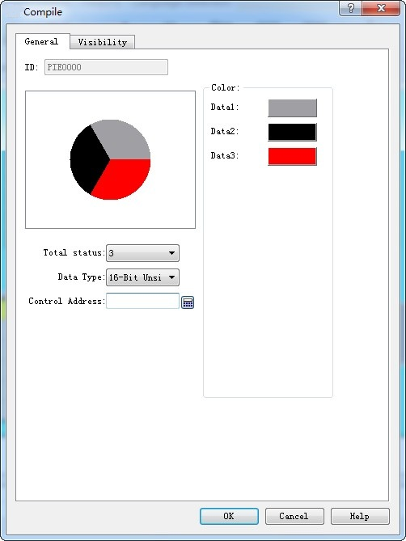

# Pie Chart

A pie chart is used to show the proportion of a certain part, simply and clearly. Click on the toolbar or double-click the existing Pie Chart button to enter the Property page.

• Total: Quantity of components. Up to 12 pieces of data can be chosen.

• Data type: what type of data is selected for each type.

• Control Address: The written address is the first needed data address. The following address is the continuous one of the first. For example, the total quantity is 3, the data type is a 16-bit positive integer, and the control address is LW5, then the address of data 1 is LW5, that of data 2 is LW6, and that of data 3 is LW7.

If the data type is 32-bit and the control address is LW5, then the address of data 1 is LW5, that of data 2 is LW7, and that of data 3 is LW9.

• Color: Set the color of each data.
