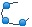

# Dynamic Circle

A dynamic circle is designed to move and change size following certain track by placing a graphic on the screen. This movement and size change are determined by the value of the monitor address. Add the dynamic graphic control and modify the dynamic graphic control properties:

Select the dynamic circle icon in the toolbar, as shown in Figure 4-56:

Figure 4-56    Dynamic circle dialog

Three sets of address values to be read by Dynamic circle represent the x-coordinate, y coordinates of the circle center and the radius of the circle respectively. The way that these three groups of addresses are read depends on the data type selected by the user.

• Control:

• Center: The circle moves according to the position of the center of the circle while the radius does not change.

• Radius: Just the radius size changes and the position do not move.

• Center & Radius: Not only the radius changes with the value of monitor address representing the radius of the circle, but also the center does with the value of monitor address representing the x, y coordinates of the circle center.

• Transparency: Change the transparency of the background color of a dynamic circle.

• Solid:

When user does not select Solid, the circle is an empty circle, which means it has no background color. Otherwise the circle is a solid circle; the background color option can change its background color.

• Border

When user does not select this option, the circle does not have change lines, and the color of the edge line cannot be changed. Otherwise, the circle is a circle with an edge line; border color options can change the color of the edge line.

Here's an example:

Select the data type "16-bit integer", and read out three sets of data consecutively to represent respectively the x coordinate, y coordinate of the center and circle radius, according to address formats of different PLC models. When the monitor address is LW1, it needs to read the address values of LW1, LW2 and LW3. The meaning of the address is as follows:

The value of LW1 is the x-coordinate of the circle center.

         The value of LW2 is the y-coordinate of the circle center.

The value of LW3 is the radius of the circle.

Regardless of whether selecting Center or Radius in the control option, HMI will still read three groups of address, which represent the same meaning. For example, you select the radius in the control bar, and the monitoring address is LW1, then still only value of LW3 can control the radius of the circle.

When select the data type "32-bit integer" and the monitor address is LW1, then it needs to read the address values of LW1, LW2 and LW3. The meaning of the address is as follows:

The value of LW1 is the x-coordinate of the circle center.

The value of LW3 is the y-coordinate of the circle center.

The value of LW5 is the radius of the circle.

When select the data type "32-bit integer", according to the address format of different PLC models, you can add 2 at interval to the monitor address to acquire three sets of data representing the x coordinate, y coordinate of the circle center and the radius respectively.

The "Visibility" page can refer to that of "Bit Button" control.
