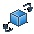

# Dynamic Rectangle

Functions of dynamic rectangle are similar to those of dynamic circle. They all reflect the dynamic state of monitor address in real time by changing the position or size of the graph according to different values of monitor address.

Select the dynamic rectangle icon in the toolbar to bring up the dialog box shown in Figure 4-57.

Figure 4-57    Dynamic rectangle dialog

The dynamic rectangle needs to read four sets of address values to represent the x-coordinate, y-coordinate, the width and height of the rectangle respectively. The way to read these four groups of addresses depends on the data type selected by the user.

• Line Width: Change the width of the line

• Type: Select the right angle, clipped angle or round angle.

• Note: Type is effectual only when the line width value is greater than 1.

Here's an example:

When select the data type "16-bit integer" and the monitor address is LW1, then it needs to read the four sets of address values LW1, LW2, LW3, and LW4. Their meanings are as follows:

The value of LW1 is the x coordinate of the rectangular;

The value of LW2 is the y coordinate of the rectangular;

The value of LW3 is the width of the rectangle;

The value of LW4 is the height of the rectangle.

In the case of selecting a data type of "16-bit integer", the user can read four sets of data consecutively according to the address specification format of the PLC model to represent the rectangle x coordinate, rectangle y coordinate, and rectangle width and height, respectively.

When the user selects the data type as "32-bit integer" and the address LW1 is monitored, the address values ​​of LW1, LW3, LW5, and LW7 need to be read out.

The value of LW1 is the rectangular x coordinate;

The value of LW3 is the rectangular y coordinate;

The value of LW5 is the width of the rectangle;

The value of LW7 is the height of the rectangle;

When select the data type "32-bit integer", according to the address format of different PLC models, you can add 2 at interval to the monitor address to acquire four sets of data representing the x coordinate, y coordinate, the width and the height of the rectangle respectively.

**Control:**

• Position: The height and width of the rectangle does not change with the corresponding monitor address value while the position of the rectangle changes with the monitor address value that represents the x and y coordinates of the rectangle.

• Size: The height and width of the rectangle changes with the following four fixed points, but the position of the rectangle does not change.

• Upper Left: The fixed point of the rectangle is in the upper left corner, and it extends in the direction of the lower right corner.

• Upper right: The fixed point of the rectangle is in the upper right corner, and it extends in the direction of the lower left corner.

• Lower Left: The fixed point of the rectangle is in the lower left corner, and it extends in the direction of the upper right corner.

• Lower right: The fixed point of the rectangle in the lower right corner, and it extends in the direction to the upper left corner.

**Solid:**

When user does not select Solid, the rectangle is an empty one, which means it has no background color. Otherwise it is a solid rectangle; the background color option can change its background color.

**Border:**

When user does not select this option, the rectangle does not have change lines, and the color of the edge line cannot be changed. Otherwise, it is a rectangle with an edge line; border color options can change the color of the edge line.

Transparency: Change the transparency of the background color of the dynamic rectangle control.

The "Visibility" page can refer to that of "Bit Button" control.
