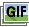
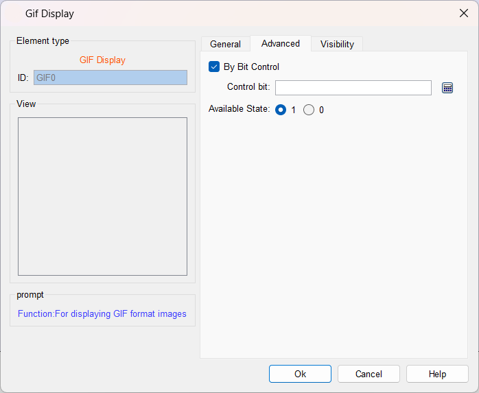

# GIF Display

GIF display can be used to display images of GIF format, supporting 32 frames at most. Operation is as follows:

Click the GIF icon on the toolbar to display the dialog box shown in Figure 4-48.

Figure 4-48    GIF Display dialog box

After setting the properties, click "OK", then the mouse cursor will become a cross in the editing area; left click to draw a rectangle and the control is added to the view area (i.e. the screen)

Select the "Advanced" page to display its properties.

Figure 4-49    GIF Display "Advanced" page

Controlled By bit: When "Controlled by Bit" is selected, if the "Active Status" selected is 1, the GIF picture will be animated if and only if the value of "Control bit" is 1, otherwise it is a static display; when the selected "Active Status" is 0, the GIF picture will be animated if and only if the value of "Control Bit" is 0, otherwise it will be displayed statically.

The "Visibility" page can refer to the use of "Bit Button" control.
