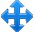
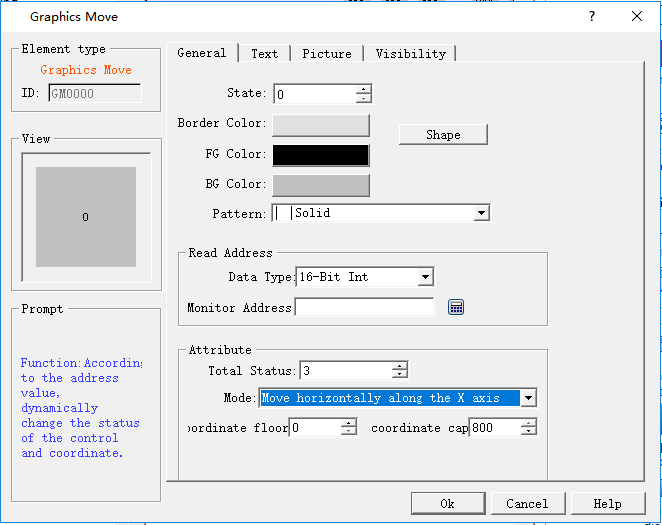

# Graphic Move

With the Graphic Move control, a gallery graphic or graphic file can move in a specific direction on the screen, and the associated variable value can trigger the movement of the variables. This control can produce an animation effect on the screen.

Add the Graphic Move control and modify its properties:

Select the Graphic Move command buttonin the toolbar; set the properties in the dialog box that pops up; and click OK, as shown in Figure 4-61:

Figure 4-61 Graphic Move dialog

• Picture selection:

On the Pictures page, select a picture as a moving graphic that can also be customized.

• Monitor Address:

The monitor address for the change of graphic movement occupies three addresses, which correspond to the change of the total status, the value of the X axis and the value of the Y axis. For example, assuming the monitor address is LW1 in the internal memory and the data type is 16 Bit. (Then the value change of LW1, LW2, LW3 can directly control the total number of state, X-axis movement and Y-axis movement); if data type is 32 Bit, then the monitor address of Total Status is LW1, that of X coordinate is LW3 and that of Y coordinate is LW5.

• Method: The following examples all take LW1 in internal storage address as the monitoring address, and the data type is 16 Bit. As an example to illustrate each movement:

• Move horizontally along the X axis: The graph moves only horizontally, but not vertically; can not move below the lower limit of X axis or above the upper limit of X axis. The total number of status is the value of the monitor address LW1 and that of the LW2 represents the X coordinate.

• Move vertically along the Y axis: The graph moves only vertically, but not horizontally; can not move below the lower limit of Y axis or above the upper limit of Y axis. The total number of status is the value of the monitor address LW1 and that of the LW2 represents the Y coordinate.

• Move horizontally and vertically in the mean time: The graph can move in horizontal and vertical direction at the same time; it cannot move below the lower limit of X-axis or above the upper limit of X-axis horizontally, or move below the lower limit of Y axis or above the upper limit of Y axis vertically. The total number of status is the value of the monitor address LW1, that of the LW2 represents the X coordinate and that of LW3 represents the coordinate.

• Move horizontally and proportionally along the X axis: The graph moves only horizontally, but not vertically; can not move below the lower limit of X axis or above the upper limit of X axis. The total number of status is the value of the monitor address LW1 and that of the LW2 represents the X coordinate.

• Move vertically and proportionally along the Y axis: The graph moves only vertically, but not horizontally; can not move below the lower limit of Y axis or above the upper limit of Y axis. The total number of status is the value of the monitor address LW1 and that of the LW2 represents the X coordinate.

• Move anti-horizontally and proportionally along the X axis: The graph moves only horizontally, but not vertically; can not move below the lower limit of X axis or above the upper limit of X axis. The total number of status is the value of the monitor address LW1 and that of the LW2 represents the X coordinate.

• Move anti-vertically and proportionally along the Y axis: The graph moves only vertically, but not horizontally; can not move below the lower limit of Y axis or above the upper limit of Y axis. The total number of status is the value of the monitor address LW1 and that of the LW2 represents the X coordinate.

• As for "Text" and "Picture" pages, refer to those of the "Multi-state Indicator" control.

• The "Visibility" page can refer to that of "Bit Button" control.

• Changing the values of the last two monitor address can control the position of the graphic movement.

• The maximum coordinate of the X / Y-axis is the maximum value of the screen.
