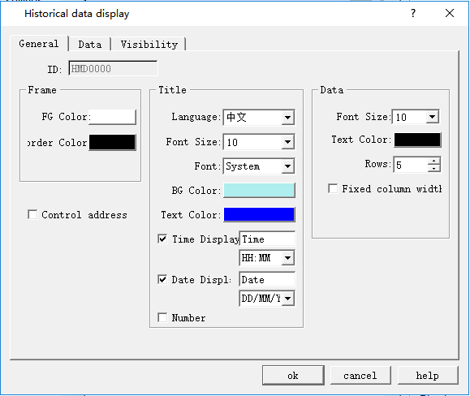
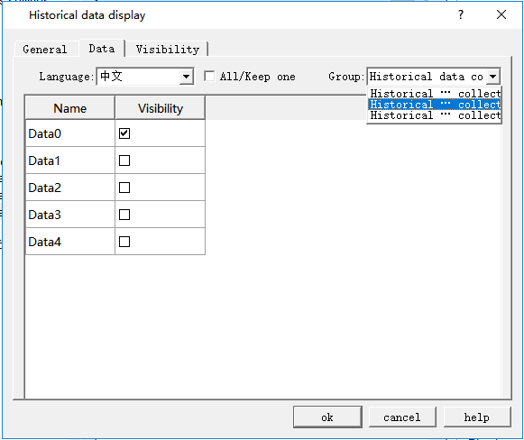
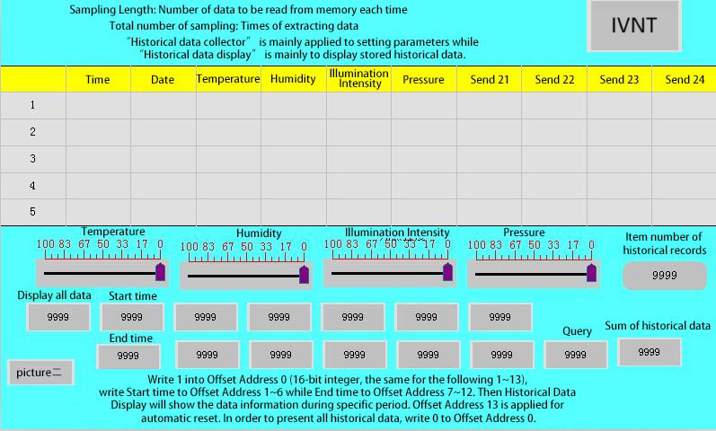
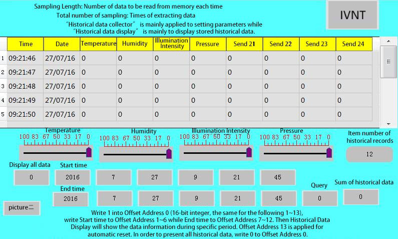

# Historical Data Display

         In actual use, data generated from PLC or other connected equipment can update at any time, such as alarm. When it comes to historical data, we can use the historical data collector in CommandHMI to observe the historical data.

CommandHMI provides the function of historical data collector. Enter the Historical data collector dialog box in the project manager. If it is a new project, right-click the "Historical data collector" to add one; then double-click "Historical Data Collector 0" to enter the setting dialog box. For details, refer to properties of "[History Data Collector](../../setting/history-data.md)" in Chapter 6.

Click on the historical data display buttonon the toolbar, and the following dialog box will pop up:

Figure 4-65 Historical Data Display dialog

**General:**

• Foreground Color: Click the color inside the box to change the foreground color of the display.

• Border Color: Click the color inside the box to change the color of the display border.

• Title: Choose the font size, font style, background color, text color and whether to display the date and time. Language settings can be referred to that of "Alarm Display".

• Data: Choose the font size, color, and the maximum line numbers to be displayed.

Control address:

Write 1 to the address register 0 in address offset (16-bit integer, same to 1 to 12); write the start time to address register 1~ 6 in address offset; write the end time to that of address register 7 ~ 12; at last write 1 to address register 13. Then the historical data display will show the data content during the corresponding time. The address register 13 will automatically reset. If you want to display all the historical alarm information, write 0 to the address register 0.

This address occupies 40 offset addresses consecutively. Meaning of each address is as follows:

|                |                                                                                                                                                                          |
|----------------|--------------------------------------------------------------------------------------------------------------------------------------------------------------------------|
| Address offset | Controlled object by control register address                                                                                                                            |
| 0              | 1 represents display the data between the start and end time; 0 means all data is displayed.                                                                             |
| 1              | Start time (Year); one word                                                                                                                                              |
| 2              | Start Time (Month); one word                                                                                                                                             |
| 3              | Start time (Day); one word                                                                                                                                               |
| 4              | Start Time (Hour); one word                                                                                                                                              |
| 5              | Start Time (Min); one word                                                                                                                                               |
| 6              | Start Time (Second); one word                                                                                                                                            |
| 7              | End time (Year); one word                                                                                                                                                |
| 8              | End Time (Month); one word                                                                                                                                               |
| 9              | End Time (Day); one word                                                                                                                                                 |
| 10             | End Time (Hour); one word                                                                                                                                                |
| 11             | End time (Minute); one word                                                                                                                                              |
| 12             | End time (Second); one word                                                                                                                                              |
| 13             | Value is from 0 to 1 and the value of address offset 0 is 1, then display the data during particular period; reset automatically; one word |
| 14             | All the historical data information between the start time and end time; double word                                                                                     |

Data:

Group number: CommandHMI provides multi-group historical data to choose.

Historical data display operation: When display historical data through control addresses, the configuration process is as follows 4-65-1:

Figure 4-65-1

In this operation, input 1 to “Display all data”, 1 to “Inquire”, then the data collector will display all the historical data during the start time and the end time period. As shown in Figure 4-65-2

Figure 4-65-2

Input 1 to “Display all data”, set the start time as 2016-7-11 3: 30: 4 and the end time as 2016-7-11 14: 39: 4; when the input value of “Inquire” is 1, then it only displays the data during this time.

The "Visibility" page can refer to that of "Bit Button" control.
