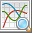
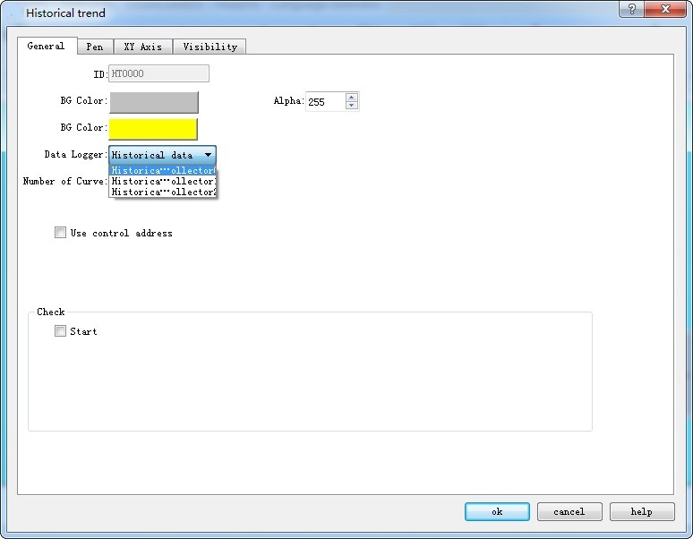
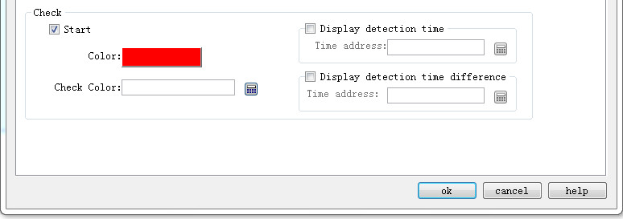
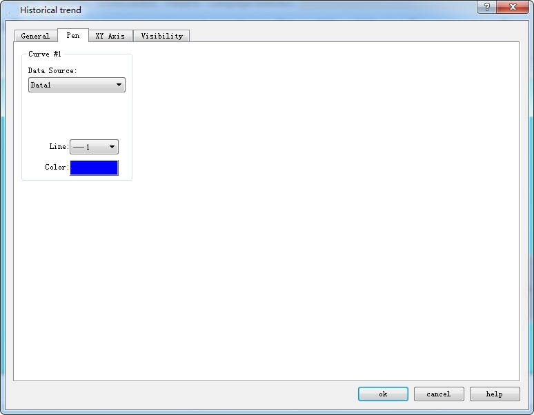
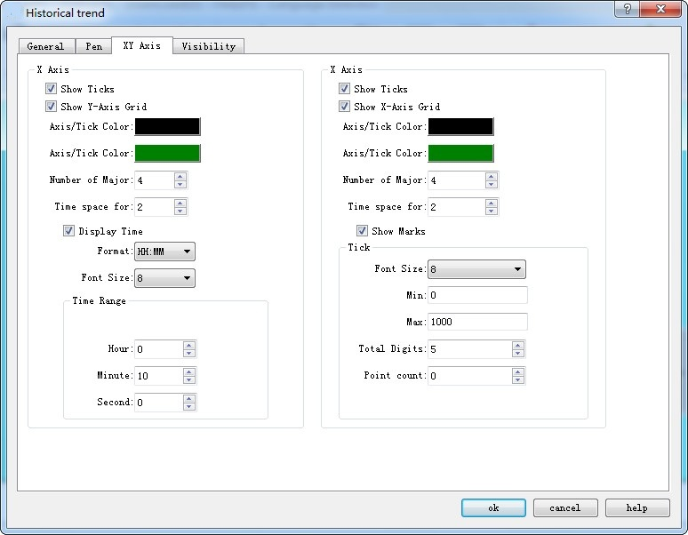

# Historical Trend Chart

• Historical Trend Chart Overview: This trend chart is used in conjunction with the“[Historical Data Collector](../../setting/history-data.md)” in the Project Manager. That is, it shows the value of the data in the "Historical Data Collector".

• Overview of XY Trend chart:

Dynamic, continuous display of variable continuous value.

Display multiple data reference curves. Take the time as the X axis, the address nvalue as the Y axis, in order to judge the change tendency of certain address value accurately and intuitively during a period of time.

Up to 8 polylines can be displayed (line graph).

• Add the trend chart and modify its properties:

1.Select the trend icon in the toolbar, the Historical Trend Property dialog box appears, as shown in Figure 4-53:

Figure 4-53    Historical Trend General page dialog box

• Background color: Change the background color of the trend chart. Change the color cannot directly see the color change, click "OK" to apply.

• Transparency: Change the transparency of the background color.

• Data Collection: The default is that from "Historical data collector " in Project Manager. CommandHMI adds multiple sets of historical data, so developers who choose this option can choose which set of historical data to use. As shown below:

• Number of curves: Number of line to be displayed; up to 8.

• Background Color: The color of the pen (or line) trace.

• Use control address: Whether to use control address. It is occupied by 28 address offset, used to control the display of each line, maximum value, minimum value, the end time of control, control time period (minutes), the maximum value when only the Y axis is displayed, the minimum value when only the Y axis is displayed whether to display the Y axis and the restoration to the initial state.

|                |                                                                                                         |
|----------------|---------------------------------------------------------------------------------------------------------|
| Address offset | Controlled object by control register address                                                           |
| 0              | Set the total number of lines displayed                                                                 |
| 1              | Whether to display 1                        |
| 2              | Whether to display 2                                                                                    |
| 3              | Whether to display 3                                                                                    |
| 4              | Whether to display 4                                                                                    |
| 5              | Whether to display 5                                                                                    |
| 6              | Whether to display 6                                                                                    |
| 7              | Whether to display 7                                                                                    |
| 8              | Whether to display 8                                                                                    |
| 9              | Maximum value in Y axis                                                                                 |
| 10             |                                                                                                         |
| 11             | Min i mu m value in Y axis                                                                              |
| 12             |                                                                                                         |
| 13             | When set to 0, use the default maximum and minimum value; when set to 1, set the upper and lower limits |
| 14             | Query start time                                                                                        |
| 15             |                                                                                                         |
| 16             |                                                                                                         |
| 17             |                                                                                                         |
| 18             |                                                                                                         |
| 19             |                                                                                                         |
| 20             | Query end time                                                                                          |
| 21             |                                                                                                         |
| 22             |                                                                                                         |
| 23             |                                                                                                         |
| 24             |                                                                                                         |
| 25             |                                                                                                         |
| 26             | When set to 1, enter the query, and return to the state 0 automatically                                 |
| 27             | When set to 1, recover to new state and return to the state 0 automatically                             |

Whether to display the control address:

**Detection**

• Enabled: Indicate whether the detection line (reference line) is enabled.

• Color: The color of the detection line (reference line).

• Detection address: Write the corresponding value to of the current detection line (reference line) to the detection address register.

• Display the detection time: the time value of the current check line (reference line) position is written in the address register, the address type is used for the ASCII display control, the total number of words is 19.

• Indicates the time difference of the detection point: the current detection line (the reference line) position time and the difference of the starting time are written in the address type, the address type USES the value to display the control, 16 integers, unit seconds.

2\. The "Line" page of the historical trend graph is shown in Figure 4-54.

Figure 4-54    Pen tab of Historical trend

This page allows setting the maximum, minimum, pattern, and color of each line. The data source is the “[Historical Data Collector](../../setting/history-data.md)” in the Project Manager. Each line can correspond to a different data source.

3\. The "XY Axis" page of the historical trend chart is shown in Figure 4-55.

Figure 4-55    XY Axis tab of Historical Trend

**X-axis**

• Display scale: whether to display the X-axis scale.

• Show Y-axis grid: Whether to display Y-axis grid.

• Axis / Scale Color: Change the color of the X-axis / scale.

• Grid Color: Change the X-axis grid color.

• Main sub-scale: X-axis main scale.

• Sub-scale: X-axis times the number of times.

• Display time: Set the time format and font size of time.

• Time Range: Set the time range displayed on the trend graph.

**Y-axis**

• Display Scale: Whether to display the Y-axis scale.

• Show X-axis grid: Whether to display the X-axis grid.

• Axis / Scale Color: This option changes the color of the Y-axis / scale.

• Grid Color: This option changes the Y-axis grid color.

• Major scale division: Numbers of Y-axis major scale.

• Sub-scale division: Numbers of Y-axis sub-scale.

• Show Marks: Whether to display the Y-axis scale mark.

• Font Size: Change the font size of the Y-axis scale.

• Minimum: The minimum value of the Y-axis scale.

• Max: The maximum value of the Y-axis scale.

• Total: Display the maximum digital number of the data.

• Decimal Place: The maximum digital number that can be displayed after the decimal point.

• Display the multi-axis: whether to display multiple axes.

The "Visibility" page can refer to that of "Bit Button" control.
