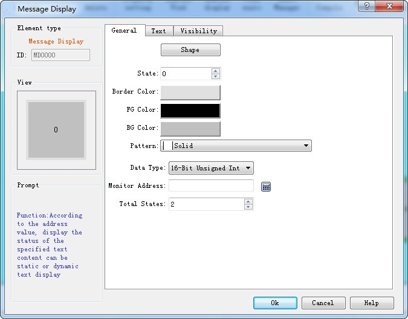
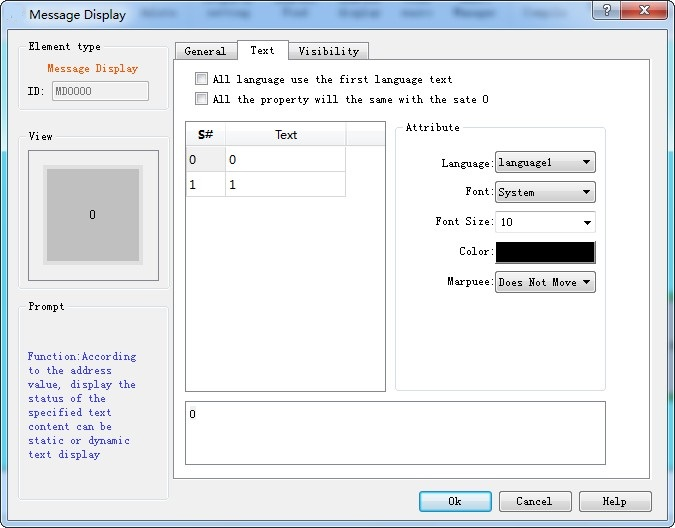

# Message Display

Message Display functions similarly to the multi-state indicator, except that the total states number of the message display control increases, which is up to 128. This control icon on the toolbar is, click it to bring up a dialog box as shown in Figure 4-66:

Figure 4-66       Message Display General page

The Text page of Message Display is shown in Figure 4-67：

Figure 4-67     Text page of Message Display

The language, font, font size and color settings can refer to those of the multi-state indicator control.

• Cursors: This item has three options-- Not move, Left and Right.

• Not move: The current state of text is static.

• Left: Text in the current state moves to the left at the speed (assumed to be n) set by user by n pixel value.

• Right: Text in the current state moves to the right at the speed (assumed to be n) set by user by n pixel value.

As for Property settings, you can refer to the attributes of "Multi-state indicator" control.
