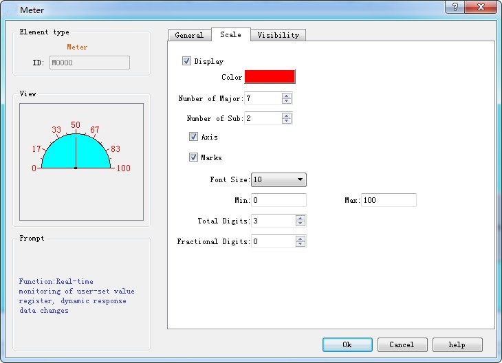
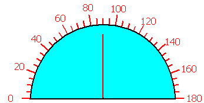

# Meter

The Meter control can display the current value of associated variables through a pointer; generally the control is a semicircle or circular, which can be a visual representation of the actual situation of the variable.

Add the Meter control and modify the properties:

1. Select the Meter control icon in the toolbar; then the dialog box shown in Figure 4-62 appears:

Figure 4-62    Meter dialog

• Needle color: Change the color of the pointer

• Needle holder Color: Change the color of the needle holder

• Background color: Change the background color of the dial

• Pointer type: Fine Line, Thick Line, Diamond and Triangle

• Background transparency: Whether the control is transparent

• Direction: Select the clockwise or counterclockwise direction

• Data type: Choose different data types according to their needs

• Monitor address: Read the address value that is shown by the pointer on the dial plate.

• Maximum: Set the maximum value that cannot be exceeded by the monitor address value

• Minimu:Set the minimum value that the monitor address value cannot be lower than

2\. Click the Scale tab to set the scale properties, as shown in Figure 4-63:

Figure 4-63    Scale tab of Meter

On this page, you can set the color, number of major scale, number of sub-scale, and whether to display the axis and whether to display the scale marks, etc.

3. In the screen editing area click to draw the control. The effect diagram of the Meter control is as follows:

Figure 4-64    Meter control

4. Select the Meter control graph, move the mouse on the 8 small green dots to modify its size; double-click to re-modify the control properties.

Meter control has a fixed aspect ratio; if modify the size, its length and width enlarge or shrink in the meantime.

The "Visibility" page can refer to that of "Bit Button" control.
